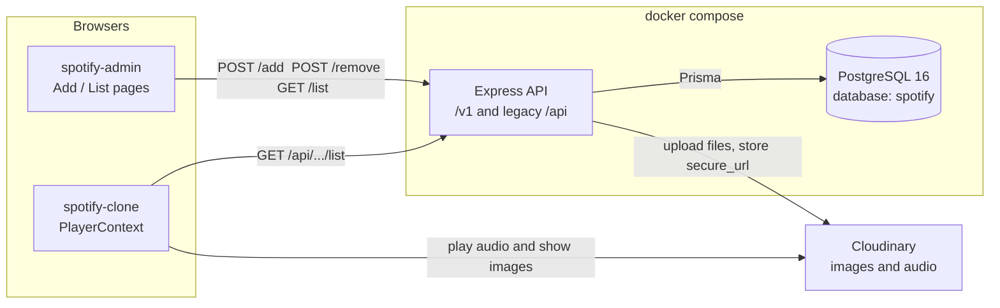
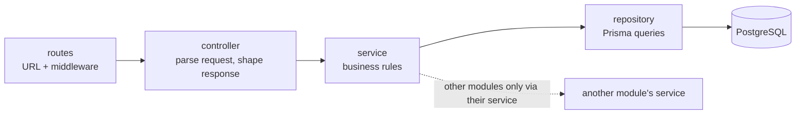
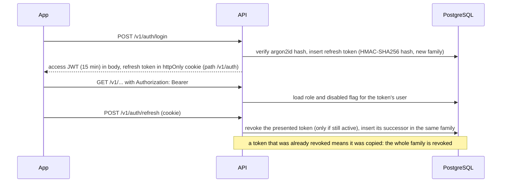
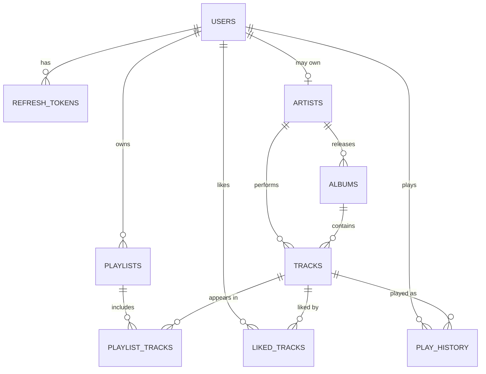
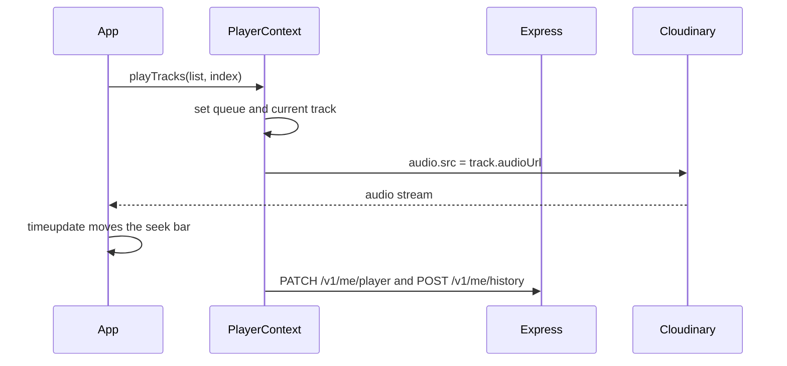
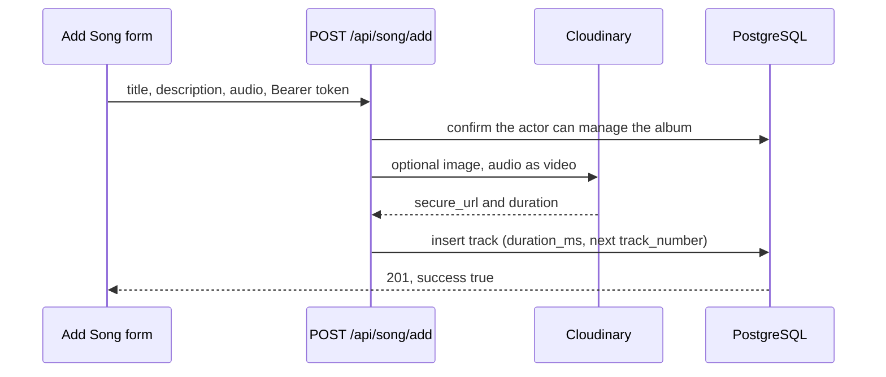

# Architecture

The Spotify clone is three apps. The listener and the admin call one Express API. PostgreSQL stores catalog metadata. Cloudinary stores cover images and audio. The player streams those Cloudinary URLs in the browser.

Both front ends call `https://spotify-clone-backend-rctz.onrender.com` through the legacy `/api` routes. The layered `/v1` API exists alongside them; the front ends move to it in Phase 0 milestone M6, and `/api` is then removed.

The million-user target, with diagrams and a phased build order, is in [SCALING-PLAN.md](SCALING-PLAN.md). Phase 0 progress is tracked in [PHASE_0_PLAN.md](PHASE_0_PLAN.md).

## System



Tracks reference albums and artists by ID, with foreign keys. The legacy `/api` responses still put the album's **name** in each song's `album` field, because the listener's album page shows songs where `item.album === album.name`.

## Backend layers



| Module | Routes | Notes |
| --- | --- | --- |
| `health` | `/v1/health`, `/v1/ready` | Liveness never touches the database; readiness pings it |
| `auth` | `/v1/auth/*` | Sessions: register, login, refresh rotation, logout. Owns `refresh_tokens`; reads accounts through `usersService` |
| `users` | `/v1/me` | Accounts and profiles; enforces the last-admin rule |
| `admin` | `/v1/admin/users*` | No repository; combines `usersService`, `artistsService` and `authService` |
| `albums` | `/v1/albums`, `/:id`, `/:id/tracks` | Album totals come from `tracksService`; deleting an album with tracks returns 409 `ALBUM_HAS_TRACKS`; adding a track goes through here |
| `artists` | `/v1/artists`, `/:id`, `/:id/albums`, `/:id/top-tracks` | Owns the "Unknown Artist" placeholder and artist ownership (`artists.access.ts`) |
| `tracks` | `/v1/tracks`, `/:id` | New tracks get the next track number in their album; `forViewer` swaps in the guest preview |
| `search` | `/v1/search` | No repository of its own; asks each catalog service to search |
| `library` | `/v1/me/likes` | Likes; keyset pages on `(liked_at, track_id)` |
| `playlists` | `/v1/playlists`, `/v1/me/playlists` | Visibility and ownership rules in the service; positions kept 0..n-1 under a row lock |
| `history` | `/v1/me/history` | Minimum-play and duplicate rules; feeds artists' top tracks |
| `player` | `/v1/me/player` | One row per user, upserted |
| `legacy` | `/api/song/*`, `/api/album/*` | Translates the old contract onto the services above; writes need an admin |

Shared pieces in `src/shared`: the Prisma client (`db.ts`), pino logger, `AppError` and error codes, the response envelope, cursor pagination, Zod validation, password hashing, token signing, temp-file cleanup and guest preview URLs. `src/middleware` holds the error handler (it maps `AppError`, Prisma, Multer and body-parser errors to the envelope without leaking stack traces, and deletes temp upload files on failure), uploads, rate limits, and authentication.

The library modules (likes, playlists, history, player) store only track IDs and get track details through `tracksService.withTracks`, which also applies the guest preview.

Two deliberate exceptions to the layer rules:

- `artists.access.ts` reads `artistsRepository` directly and is imported by the albums and tracks services. Going through `artistsService` would create an import cycle, because that service already uses theirs.
- `albumsRepository.reassignArtist` also updates `tracks.artist_id` in the same transaction. A track's artist must always equal its album's artist, and splitting the update across two services would lose atomicity.

### Authentication and authorization



- `authenticate` requires a valid token. `optionalAuthenticate` lets guests through but still rejects a bad token, so clients refresh instead of silently getting guest data. `requireRole(...)` is `authenticate` plus a role check: 401 for guests, 403 for other roles.
- Ownership is checked in services (`assertCanManageArtist`), not in routes, because it needs the database.
- The access token carries only the user ID. Role changes and disabling apply on the next request, at the cost of one indexed lookup per authenticated request.
- Rate-limit counters are in memory and per instance. Phase 1 moves them to Redis.

### Pagination

Lists fetch `limit + 1` rows. The extra row only signals another page. `meta.nextCursor` is base64url JSON holding the last row's ID, which Prisma uses as a keyset cursor. IDs are UUIDv7, so they sort by creation time. Search pages by offset, since its order is by relevance.

### Search

`pg_trgm` GIN indexes on `tracks.title`, `albums.title`, and `artists.name` back two conditions: `ILIKE '%q%'` for substrings, and `q <% column` (word similarity of at least 0.6) for typos such as "midnite" finding "Midnight Drive". Results are ordered by word similarity, then whole-string similarity.

## Data model



The full schema is [`backend/prisma/schema.prisma`](backend/prisma/schema.prisma). Delete behaviour is deliberate: albums and tracks are `RESTRICT`, so an album with tracks and an artist with albums cannot be deleted; user-owned rows such as playlists, likes, and history cascade. Check constraints in the first migration keep emails lowercase, track numbers positive, and volume between 0 and 100. `legacy_mongo_id` on albums and tracks traces rows back to MongoDB and is dropped in Phase 1.

## Code map

```text
Spotify-clone/
├── docker-compose.yml      postgres, api; pgadmin + mailpit (profile dev); mongo (profile migration)
├── docker/                 postgres init (creates spotify_test), pgadmin server list
├── spotify-clone/          Listener UI
│   └── src/
│       ├── api/            axios client (in-memory access token, silent refresh)
│       ├── context/        AuthContext, PlayerContext (playback only)
│       ├── pages/          Login, Signup, Profile
│       └── components/     Display, DisplayHome, DisplayAlbum, Player, Sidebar, Navbar
├── spotify-admin/          Catalog admin (artist + admin)
│   └── src/
│       ├── api/            /v1 client, catalog and admin helpers
│       ├── context/        AuthContext
│       ├── components/     Sidebar (role-aware), Navbar
│       └── pages/          Login, albums, songs, artists, users
└── backend/
    ├── Dockerfile          dev target (tsx watch) and runtime target (compiled, non-root)
    ├── prisma/             schema and migrations
    ├── scripts/            legacy backup and Mongo-to-Postgres migration
    ├── test/               integration tests
    └── src/
        ├── server.ts, app.ts
        ├── config/         env (Zod-validated), cloudinary
        ├── shared/         db, logger, errors, response, pagination, validate, search
        ├── middleware/     error-handler, upload
        └── modules/        health, albums, artists, tracks, search, legacy
```

| App | Stack | Role |
| --- | --- | --- |
| `spotify-clone` | React 18, React Router 6, Axios, Tailwind | Browse and play |
| `spotify-admin` | React 18, React Router 6, Axios, MUI, Toastify, Tailwind | Add and remove catalog items |
| `backend` | Express 5, TypeScript, Prisma 6, PostgreSQL 16, Zod, pino, helmet, Multer, Cloudinary | Persist metadata and files |

## Playback

`PlayerContext` owns the current track, the queue, volume, shuffle, repeat, and seek time. Catalog and library pages fetch their own `/v1` data. `LibraryContext` keeps liked-track IDs and the sidebar playlist list.



| Step | Where | What happens |
| --- | --- | --- |
| 1 | `main.jsx` | `BrowserRouter`, `AuthProvider`, `LibraryProvider`, `PlayerContextProvider`. |
| 2 | `AuthContext` | Restores the session from the refresh cookie; access token stays in memory. |
| 3 | Pages | Home, album, artist, search, liked, and playlist each load `/v1` lists. |
| 4 | `/` | Recently played, featured albums, and biggest hits. |
| 5 | `/album/:id`, `/artist/:id` | Album gradient and artist top tracks plus albums. |
| 6 | `Player` | Play, pause, next, previous, seek, volume, mute, shuffle, repeat, queue, and like. |

## Upload

Admin writes use `multipart/form-data`. Multer checks file type and size and writes to the OS temp folder under a random name. The service uploads to Cloudinary, stores the URLs in PostgreSQL, and deletes the temp files.



| Admin route | Page | API |
| --- | --- | --- |
| `/add-album` | `AddAlbum` | `POST /v1/albums` |
| `/list-album` | `ListAlbum` | `GET /v1/albums`, `DELETE /v1/albums/:id` |
| `/add-song` | `AddSong` | `POST /v1/albums/:id/tracks` |
| `/list-song` | `ListSong` | `GET /v1/tracks`, `DELETE /v1/tracks/:id` |
| `/add-artist`, `/list-artist` | admin | `POST /v1/artists`, `GET /v1/artists`, `DELETE /v1/artists/:id` |
| `/users` | admin | `GET /v1/admin/users`, role and status patches |

Deleting a song or album removes the database row and leaves the Cloudinary file in place.

## Decisions recorded for Phase 0

| Question | Decision |
| --- | --- |
| Backend language | TypeScript |
| Can guests play music? | 30-second preview through Cloudinary's `du_30` transformation on every `/v1` track response. Both apps now call `/v1`. Not DRM: the full file stays public until Phase 2. |
| Legacy write routes once accounts exist | Still admin-only on `/api`; the admin app writes through `/v1` since M6 |
| Refresh token storage | httpOnly cookie scoped to `/v1/auth`; rotated on every use; stored as an HMAC so a database leak alone cannot replay tokens |
| Deleting an album that has tracks | Blocked with 409 `ALBUM_HAS_TRACKS` |
| Old songs without an artist | Placeholder "Unknown Artist", fixed later in the admin app |
