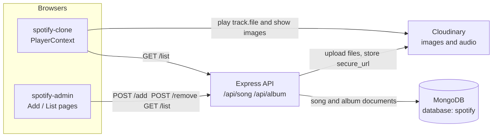
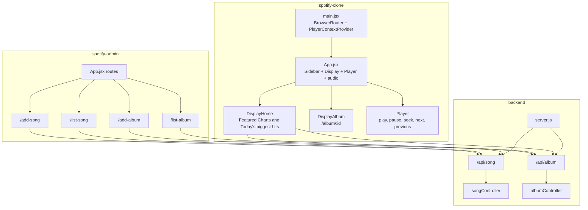
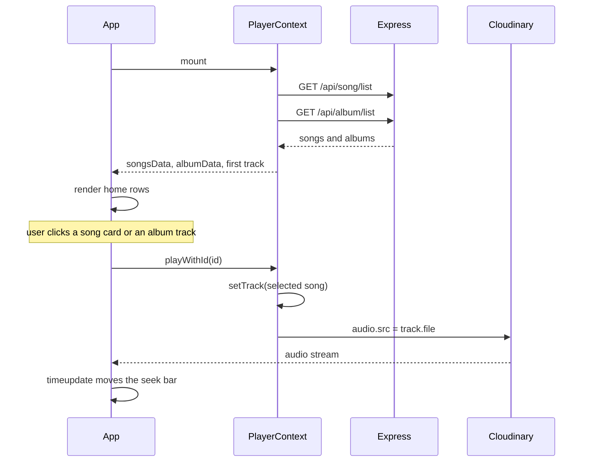
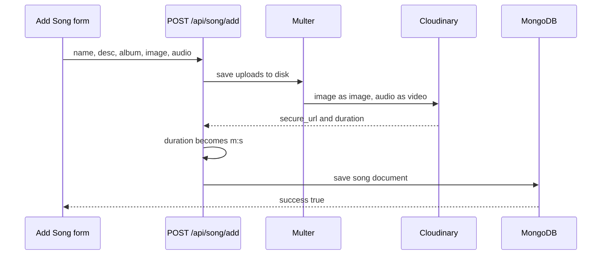

# Architecture

The Spotify clone is three apps. The listener and the admin call one Express API. MongoDB stores album and song metadata. Cloudinary stores cover images and audio. The player streams those Cloudinary URLs in the browser.

Both front ends call `https://spotify-clone-backend-rctz.onrender.com`.

The million-user target, with diagrams and a phased build order, is in [SCALING-PLAN.md](SCALING-PLAN.md).

## System



A song belongs to an album by **name**. `song.album` is the album `name` string. The album page shows songs where `item.album === album.name`.

## Code map



```text
Spotify-clone/
├── spotify-clone/          Listener UI
│   └── src/
│       ├── main.jsx        Router + PlayerContextProvider
│       ├── App.jsx         Sidebar, Display, Player, audio element
│       ├── context/PlayerContext.jsx
│       └── components/     Display, DisplayHome, DisplayAlbum, Player, Sidebar, Navbar
├── spotify-admin/          Catalog admin
│   └── src/
│       ├── App.jsx         Sidebar routes and API base URL
│       ├── components/     Sidebar, Navbar
│       └── pages/          AddSong, ListSong, AddAlbum, ListAlbum
└── backend/
    ├── server.js           Express, CORS, route mounts
    └── src/
        ├── config/         mongodb.js, cloudinary.js
        ├── middleware/     multer.js
        ├── models/         songModel.js, albumModel.js
        ├── controllers/    songController.js, albumController.js
        └── routes/         songRoute.js, albumRoute.js
```

| App | Stack | Role |
| --- | --- | --- |
| `spotify-clone` | React 18, React Router 6, Axios, Tailwind | Browse and play |
| `spotify-admin` | React 18, React Router 6, Axios, MUI, Toastify, Tailwind | Add and remove catalog items |
| `backend` | Express 4, Mongoose, Multer, Cloudinary | Persist metadata and files |

## Playback

`PlayerContext` owns songs, albums, the current track, play state, and seek time. Every playback control reads that context.



| Step | Where | What happens |
| --- | --- | --- |
| 1 | `main.jsx` | Wraps the tree in `BrowserRouter` and `PlayerContextProvider`. |
| 2 | `PlayerContext` | Loads both lists and sets the first song as `track`. |
| 3 | `App` | After songs arrive, renders the sidebar, display, player, and a hidden `<audio>` tag. |
| 4 | `/` | Albums in “Featured Charts”. Songs in “Today's biggest hits”. |
| 5 | `/album/:id` | Gradient from `bgColor`. Track list filtered by album name. Row click calls `playWithId`. |
| 6 | `Player` | Play, pause, next, previous, and seek drive the audio element. |

## Upload

Admin writes use `multipart/form-data`. Multer accepts the files, Cloudinary stores them, and MongoDB stores the URLs.



| Admin route | Page | API |
| --- | --- | --- |
| `/add-album` | `AddAlbum` | `POST /api/album/add` |
| `/list-album` | `ListAlbum` | `GET /api/album/list`, `POST /api/album/remove` |
| `/add-song` | `AddSong` | `POST /api/song/add` |
| `/list-song` | `ListSong` | `GET /api/song/list`, `POST /api/song/remove` |

Audio is uploaded with Cloudinary `resource_type: "video"` so the response includes duration. The API stores that as `minutes:seconds`. Deleting a song or album removes the MongoDB document and leaves the Cloudinary file in place.

## API and data

`server.js` connects MongoDB and Cloudinary, then mounts the routers. The database name is `spotify`.

| Method | Path | Result |
| --- | --- | --- |
| `GET` | `/` | `Api working` |
| `POST` | `/api/song/add` | Saves `{ name, desc, album, image, file, duration }` |
| `GET` | `/api/song/list` | `{ success: true, songs }` |
| `POST` | `/api/song/remove` | Deletes by `{ id }` |
| `POST` | `/api/album/add` | Saves `{ name, desc, bgColor, image }` |
| `GET` | `/api/album/list` | `{ success: "true", album }` |
| `POST` | `/api/album/remove` | Deletes by `{ id }` |

**Song:** `name`, `desc`, `album`, `image`, `file`, `duration`.

**Album:** `name`, `desc`, `bgColor`, `image`.

Song responses use boolean `success`. Album responses use the strings `"true"` and `"false"`.
