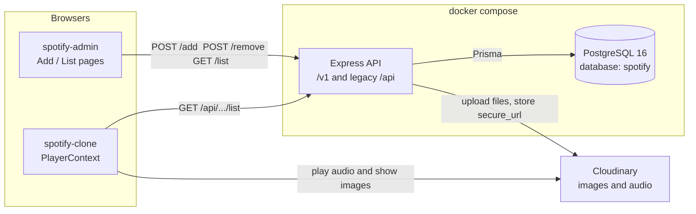
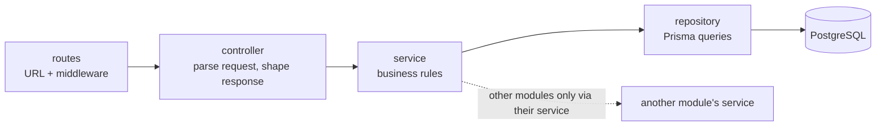
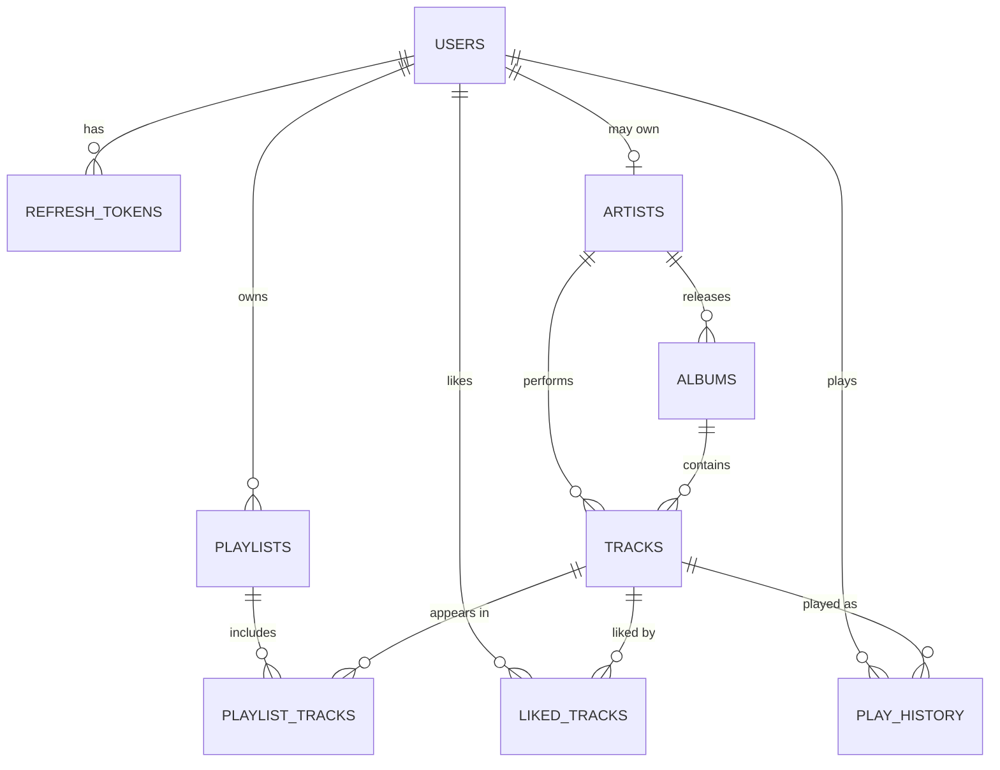
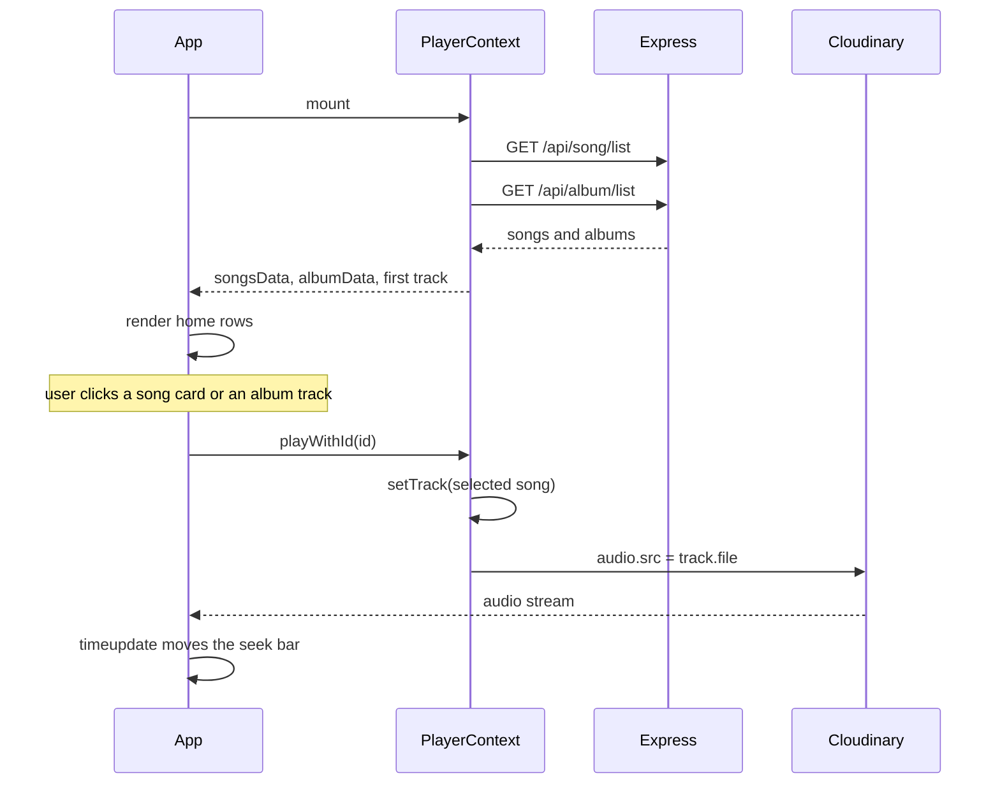
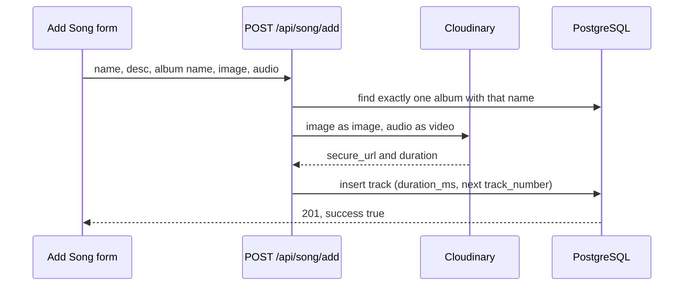

# Architecture

The Spotify clone is three apps. The listener and the admin call one Express API. PostgreSQL stores catalog metadata. Cloudinary stores cover images and audio. The player streams those Cloudinary URLs in the browser.

Both front ends call `https://spotify-clone-backend-rctz.onrender.com` through the legacy `/api` routes. The layered `/v1` API exists alongside them; the front ends move to it in Phase 0 milestone M6, and `/api` is then removed.

The million-user target, with diagrams and a phased build order, is in [SCALING-PLAN.md](SCALING-PLAN.md). Phase 0 progress is tracked in [PHASE_0_PLAN.md](PHASE_0_PLAN.md).

## System



Tracks reference albums and artists by ID, with foreign keys. The legacy `/api` responses still put the album's **name** in each song's `album` field, because the listener's album page shows songs where `item.album === album.name`.

## Backend layers



| Module | Routes | Notes |
| --- | --- | --- |
| `health` | `/v1/health`, `/v1/ready` | Liveness never touches the database; readiness pings it |
| `albums` | `/v1/albums`, `/:id`, `/:id/tracks` | Album totals come from `tracksService`; deleting an album with tracks returns 409 `ALBUM_HAS_TRACKS` |
| `artists` | `/v1/artists`, `/:id`, `/:id/albums`, `/:id/top-tracks` | Owns the "Unknown Artist" placeholder |
| `tracks` | `/v1/tracks`, `/:id` | New tracks get the next track number in their album |
| `search` | `/v1/search` | No repository of its own; asks each catalog service to search |
| `legacy` | `/api/song/*`, `/api/album/*` | Translates the old contract onto the services above |

Shared pieces in `src/shared`: the Prisma client (`db.ts`), pino logger, `AppError` and error codes, the response envelope, cursor pagination, and Zod validation. `src/middleware` holds the error handler, which maps `AppError`, Prisma, Multer, and body-parser errors to the envelope without leaking stack traces, and deletes temp upload files on failure.

### Pagination

Lists fetch `limit + 1` rows. The extra row only signals another page. `meta.nextCursor` is base64url JSON holding the last row's ID, which Prisma uses as a keyset cursor. IDs are UUIDv7, so they sort by creation time. Search pages by offset, since its order is by relevance.

### Search

`pg_trgm` GIN indexes on `tracks.title`, `albums.title`, and `artists.name` back two conditions: `ILIKE '%q%'` for substrings, and `q <% column` (word similarity of at least 0.6) for typos such as "midnite" finding "Midnight Drive". Results are ordered by word similarity, then whole-string similarity.

## Data model



The full schema is [`backend/prisma/schema.prisma`](backend/prisma/schema.prisma). Delete behaviour is deliberate: albums and tracks are `RESTRICT`, so an album with tracks and an artist with albums cannot be deleted; user-owned rows such as playlists, likes, and history cascade. Check constraints in the first migration keep emails lowercase, track numbers positive, and volume between 0 and 100. `legacy_mongo_id` on albums and tracks traces rows back to MongoDB and is dropped in Phase 1.

## Code map

```text
Spotify-clone/
├── docker-compose.yml      postgres, api; pgadmin + mailpit (profile dev); mongo (profile migration)
├── docker/                 postgres init (creates spotify_test), pgadmin server list
├── spotify-clone/          Listener UI
│   └── src/
│       ├── main.jsx        Router + PlayerContextProvider
│       ├── App.jsx         Sidebar, Display, Player, audio element
│       ├── context/PlayerContext.jsx
│       └── components/     Display, DisplayHome, DisplayAlbum, Player, Sidebar, Navbar
├── spotify-admin/          Catalog admin
│   └── src/
│       ├── App.jsx         Sidebar routes and API base URL
│       ├── components/     Sidebar, Navbar
│       └── pages/          AddSong, ListSong, AddAlbum, ListAlbum
└── backend/
    ├── Dockerfile          dev target (tsx watch) and runtime target (compiled, non-root)
    ├── prisma/             schema and migrations
    ├── scripts/            legacy backup and Mongo-to-Postgres migration
    ├── test/               integration tests
    └── src/
        ├── server.ts, app.ts
        ├── config/         env (Zod-validated), cloudinary
        ├── shared/         db, logger, errors, response, pagination, validate, search
        ├── middleware/     error-handler, upload
        └── modules/        health, albums, artists, tracks, search, legacy
```

| App | Stack | Role |
| --- | --- | --- |
| `spotify-clone` | React 18, React Router 6, Axios, Tailwind | Browse and play |
| `spotify-admin` | React 18, React Router 6, Axios, MUI, Toastify, Tailwind | Add and remove catalog items |
| `backend` | Express 5, TypeScript, Prisma 6, PostgreSQL 16, Zod, pino, helmet, Multer, Cloudinary | Persist metadata and files |

## Playback

`PlayerContext` owns songs, albums, the current track, play state, and seek time. Every playback control reads that context.



| Step | Where | What happens |
| --- | --- | --- |
| 1 | `main.jsx` | Wraps the tree in `BrowserRouter` and `PlayerContextProvider`. |
| 2 | `PlayerContext` | Loads both lists and sets the first song as `track`. |
| 3 | `App` | After songs arrive, renders the sidebar, display, player, and a hidden `<audio>` tag. |
| 4 | `/` | Albums in “Featured Charts”. Songs in “Today's biggest hits”. |
| 5 | `/album/:id` | Gradient from `bgColor`. Track list filtered by album name. Row click calls `playWithId`. |
| 6 | `Player` | Play, pause, next, previous, and seek drive the audio element. |

## Upload

Admin writes use `multipart/form-data`. Multer checks file type and size and writes to the OS temp folder under a random name. The service uploads to Cloudinary, stores the URLs in PostgreSQL, and deletes the temp files.



| Admin route | Page | API |
| --- | --- | --- |
| `/add-album` | `AddAlbum` | `POST /api/album/add` |
| `/list-album` | `ListAlbum` | `GET /api/album/list`, `POST /api/album/remove` |
| `/add-song` | `AddSong` | `POST /api/song/add` |
| `/list-song` | `ListSong` | `GET /api/song/list`, `POST /api/song/remove` |

Deleting a song or album removes the database row and leaves the Cloudinary file in place.

## Decisions recorded for Phase 0

| Question | Decision |
| --- | --- |
| Backend language | TypeScript |
| Can guests play music? | 30-second preview; enforced once accounts exist (M4) |
| Deleting an album that has tracks | Blocked with 409 `ALBUM_HAS_TRACKS` |
| Old songs without an artist | Placeholder "Unknown Artist", fixed later in the admin app |
