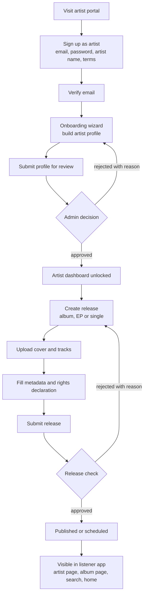
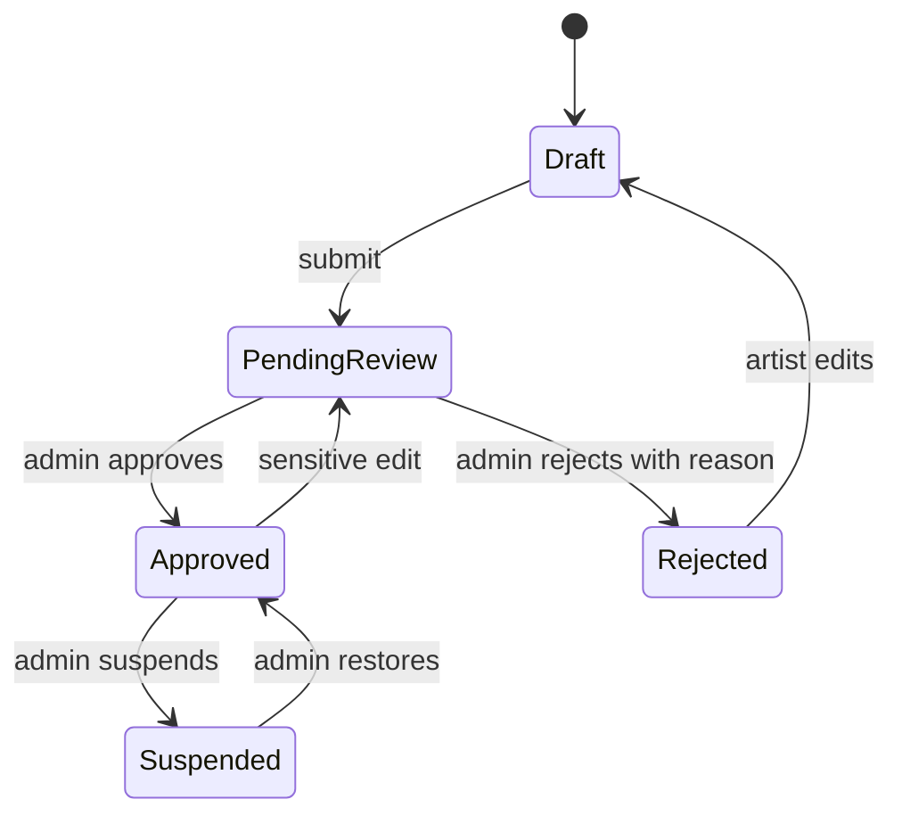
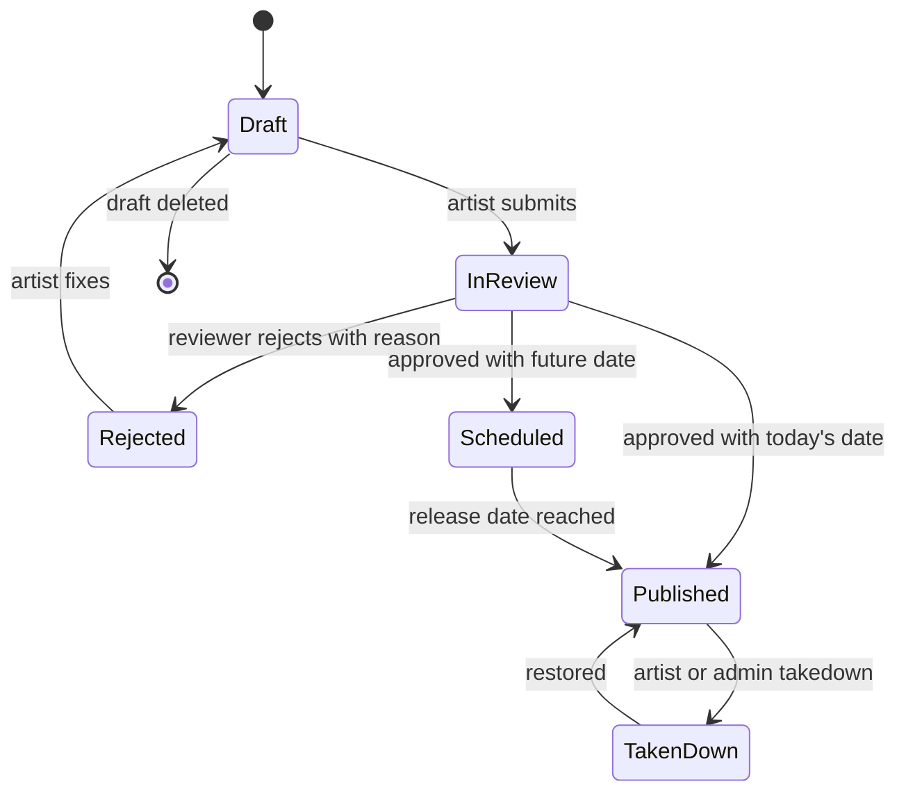

# Artist Portal Requirements

**Product:** `spotify-admin`, rebuilt as an **Artist Portal** (plus a separate admin area)
**Goal:** an artist can create an account, build a detailed public profile, upload albums and songs, and see them live in the listener app after review.

This is a requirements document. It contains no implementation code.

> **Change from the earlier plan:** Phase 0 said an admin grants the `artist` role. You now want **self-service artist signup**. The safe way to do that is: anyone can sign up as an artist, but nothing becomes public until an admin approves the artist profile. This document is built around that rule.

---

## 1. Scope

### 1.1 In scope

1. Artist account creation and login
2. Artist profile (public page data and private account data)
3. Profile review and approval by an admin
4. Release management: albums, EPs, singles, and their tracks
5. Audio and image upload with validation
6. Release lifecycle: draft, review, scheduled, published, taken down
7. Visibility of approved content in the listener app
8. Basic artist dashboard and statistics
9. Admin moderation tools for the above
10. Fixing the problems in the current admin app (section 2)

### 1.2 Out of scope for now

Payments and royalties, distribution to other platforms, record-label accounts with many artists, merchandise and ticketing, lyrics syncing, podcasts, ad campaigns, mobile artist app.

---

## 2. What is wrong in the current admin app

These are the problems to fix. Each is traceable to the current design.

| # | Problem today | Impact | Required fix |
| --- | --- | --- | --- |
| 1 | No login; anyone who finds the URL can add or delete anything | Critical security hole | Authentication and roles (section 4) |
| 2 | No artist concept; a song has only a name, description, album and files | Cannot build a profile | Artist entity and profile (section 5) |
| 3 | Song is linked to album by album **name** | Renames and duplicates break data | Link by ID |
| 4 | Every user sees **every** album and song | Artists could delete each other's work | Artists see only their own content |
| 5 | Only add, list and delete; **no edit** | A typo means delete and re-upload | Edit for profile, albums and tracks |
| 6 | No draft or review state; upload is instantly live | Wrong or illegal content goes public | Release lifecycle (section 7) |
| 7 | No input validation or file checks | Bad files and bad data accepted | Validation rules (sections 5 to 7) |
| 8 | Lists have no pagination, search or sorting | Unusable beyond a few dozen items | Server-side pagination, search, sort |
| 9 | Upload blocks until finished, with no progress | Looks frozen on large audio | Upload progress and background processing |
| 10 | Delete leaves the file in storage | Storage leak | Clean-up on delete |
| 11 | API URL hardcoded; success is sometimes boolean and sometimes string | Fragile | Environment config; one response format |
| 12 | One flat list of four pages | No dashboard, no profile, no sense of workflow | New navigation (section 12) |
| 13 | No notifications or status messages beyond toasts | Artist never learns a release was rejected | Notifications (section 10) |
| 14 | No audit trail | Cannot tell who changed what | Audit log (section 11) |

---

## 3. Actors

| Actor | Description | Can do |
| --- | --- | --- |
| **Visitor** | Not logged in | Sign up, log in, read terms |
| **Artist (pending)** | Has an account, profile not yet approved | Edit profile, upload drafts, submit for review. Nothing is public. |
| **Artist (approved)** | Profile approved by admin | Everything above, plus publish releases |
| **Artist (suspended)** | Blocked by admin | Log in and read only; content hidden |
| **Moderator or admin** | Reviews artists and releases, handles reports | Approve, reject, take down, manage users |
| **Listener** | Uses the listener app | Sees approved artists and published releases only |

---

## 4. Artist journey

---

## 5. Account requirements

### 5.1 Sign up

| ID | Requirement | Priority |
| --- | --- | --- |
| ACC-1 | An artist signs up with email, password, confirm password, artist name, and acceptance of Terms and the Content Policy | P1 |
| ACC-2 | Email must be unique; stored lowercase; format validated | P1 |
| ACC-3 | Password minimum 10 characters, blocked if on a common-password list, strength meter shown | P1 |
| ACC-4 | Artist name must be unique (case-insensitive) or the artist is warned about a similar existing name and must confirm | P1 |
| ACC-5 | A verification email is sent; the portal is read-only until the email is verified | P1 |
| ACC-6 | The account role is `artist`; it can never become `admin` through signup | P1 |
| ACC-7 | Rate limit signup per IP; add a bot check (captcha) | P2 |
| ACC-8 | Sign up with Google | P3 |

### 5.2 Login and account safety

| ID | Requirement | Priority |
| --- | --- | --- |
| ACC-9 | Login with email and password; generic error on failure | P1 |
| ACC-10 | Session survives page reload; logout from this device and from all devices | P1 |
| ACC-11 | Forgot and reset password by email link that expires in 30 minutes and works once | P1 |
| ACC-12 | Change password and change email (email change requires re-verification) | P2 |
| ACC-13 | Two-factor authentication with an authenticator app | P3 |
| ACC-14 | Delete account: artist chooses to unpublish everything first; deletion is delayed by 14 days so it can be undone | P3 |

---

## 6. Artist profile requirements

The profile has a **public** part (shown in the listener app) and a **private** part (only the artist and admins see it).

### 6.1 Public profile fields

| Field | Required | Rules |
| --- | --- | --- |
| Artist name | Yes | 2 to 80 characters; unique |
| Profile URL slug | Yes | Auto-generated from name, editable once; lowercase letters, numbers, hyphens; unique |
| Profile picture | Yes | Square, minimum 640 x 640 pixels, JPG or PNG, maximum 5 MB, cropped in the browser |
| Header banner image | No | Wide ratio (for example 2660 x 1140), JPG or PNG, maximum 8 MB |
| Short bio | Yes | 20 to 500 characters |
| Long biography ("About") | No | Up to 3,000 characters, basic formatting only |
| Genres | Yes | 1 to 3 from a fixed list managed by admin |
| Country | Yes | From a country list |
| City | No | Free text |
| Languages | No | One or more |
| Year formed or started | No | Four digit year, not in the future |
| Artist type | Yes | Solo, band, duo, group, DJ, orchestra, other |
| Members | No | For bands: names and roles |
| Social links | No | Instagram, YouTube, X, Facebook, TikTok, SoundCloud, each validated as a URL on the correct domain |
| Official website | No | Valid HTTPS URL |
| Featured track ("Artist pick") | No | One of the artist's published tracks |
| Gallery images | No | Up to 6 images, maximum 5 MB each |

### 6.2 Private fields (never shown publicly)

| Field | Required | Purpose |
| --- | --- | --- |
| Legal or real name | Yes | Identity and rights checks |
| Contact email | Yes | Admin and review messages |
| Phone number | No | Optional verification |
| Proof of identity or ownership | No | Link to an official social account, or an uploaded document, used for the verified badge |
| Management or label name | No | Information only |
| Payout details | No | Reserved for later; do not build now |

### 6.3 Profile requirements

| ID | Requirement | Priority |
| --- | --- | --- |
| PRO-1 | A step-by-step **onboarding wizard**: basics, images, bio, links, review and submit | P1 |
| PRO-2 | Progress is saved as a draft at every step; the artist can leave and resume | P1 |
| PRO-3 | Live **preview** of how the profile will look in the listener app | P1 |
| PRO-4 | The artist can edit every public field after approval; sensitive edits (name, picture, bio) go back through review, small edits (links, city) apply immediately | P1 |
| PRO-5 | Image upload with in-browser crop, size and format checks, and clear error messages | P1 |
| PRO-6 | Profile completeness meter (for example "80% complete") with hints | P2 |
| PRO-7 | A **Verified** badge, granted only by an admin after identity checks | P2 |
| PRO-8 | Profile shows counts such as releases and followers; monthly listeners is a later feature | P2 |
| PRO-9 | The artist can invite team members (manager, editor) with limited roles | P3 |

### 6.4 Profile status

Only **Approved** profiles appear in the listener app.

---

## 7. Release management requirements

A **release** is an album, EP, single or compilation. A **track** is a song inside a release.

### 7.1 Release (album) fields

| Field | Required | Rules |
| --- | --- | --- |
| Release type | Yes | Single (1 to 3 tracks), EP (4 to 6), Album (7 or more), Compilation. Type is suggested from track count, artist may override. |
| Title | Yes | 1 to 120 characters; unique per artist |
| Main artist | Yes | The artist's own profile (fixed) |
| Additional artists | No | Other approved artists on the platform (featured) |
| Cover art | Yes | Square, minimum 1400 x 1400 pixels, JPG or PNG, maximum 10 MB, no blurry or placeholder art, no URLs or prices on the image |
| Release date | Yes | Today or a future date; past dates allowed only for catalog releases the artist declares |
| Primary genre | Yes | From the genre list |
| Secondary genre | No | |
| Description | No | Up to 1,000 characters |
| Label | No | Defaults to the artist name |
| Copyright line | Yes | Year and owner for the composition and for the recording |
| Background colour | Auto | Extracted from the cover; the artist may change it. This feeds the album page gradient. |
| Explicit content flag | Computed | True if any track is explicit |
| UPC code | No | Optional identifier |

### 7.2 Track fields

| Field | Required | Rules |
| --- | --- | --- |
| Title | Yes | 1 to 120 characters |
| Track number and disc number | Yes | Numbers; reorder by drag and drop |
| Audio file | Yes | WAV, FLAC or MP3; maximum 200 MB; minimum 30 seconds; maximum 20 minutes; MP3 at least 192 kbps |
| Duration | Auto | Read from the file, never typed by hand |
| Featured artists | No | Selected from platform artists |
| Explicit | Yes | Yes or No |
| Language | No | |
| Songwriters, composers, producers | No | Names and roles (credits) |
| ISRC code | No | Optional; validated format |
| Lyrics | No | Plain text; synced lyrics are a later feature |
| Track-level cover | No | Defaults to the release cover |

### 7.3 Release and track requirements

| ID | Requirement | Priority |
| --- | --- | --- |
| REL-1 | Create, edit, and delete releases as draft; add, remove, and reorder tracks | P1 |
| REL-2 | Tracks are always linked to a release **by ID** and to the artist by ID | P1 |
| REL-3 | Upload shows a progress bar; large files upload directly to storage; processing runs in the background; the track shows "Processing", "Ready" or "Failed" | P1 |
| REL-4 | Files are validated on the server (type by content, not by extension; size; duration; corrupted files rejected) | P1 |
| REL-5 | A rights declaration checkbox must be accepted per release: "I own or control all rights to this content" | P1 |
| REL-6 | The release cannot be submitted until every required field is complete and every track is Ready | P1 |
| REL-7 | An artist sees and manages **only their own** releases and tracks | P1 |
| REL-8 | After publishing, the artist can edit descriptive data (title typos, credits, description); changing audio or cover creates a new version that goes through review again | P2 |
| REL-9 | **Scheduling:** an approved release can have a future release date; it becomes visible automatically at that time | P2 |
| REL-10 | **Takedown:** the artist can unpublish a release; an admin can take it down with a reason | P1 |
| REL-11 | Deleting a published release is not allowed; use takedown (soft delete). Drafts can be deleted completely, including their files | P1 |
| REL-12 | Duplicate detection: warn if the same title and artist already exist | P2 |
| REL-13 | Bulk upload: drop many files and the portal creates tracks and guesses titles from file names | P3 |
| REL-14 | Versioning, such as remixes, and release regions are later features | P3 |

### 7.4 Release status

**Visibility rule for the listener app:** a track and album are visible only when the artist is **Approved** and the release is **Published**. Anything else returns "not found" to listeners.

---

## 8. Visibility in the listener app

Everything below must work automatically for approved content, with no manual step.

| Listener app area | Requirement |
| --- | --- |
| **Artist page** (new) | Banner, profile picture, name, verified badge, genres, bio, "Popular" top tracks, discography grouped into Albums, Singles and EPs, "Appears on" featured tracks, social links, About section |
| **Album page** | Cover, release type, artist name as a link to the artist page, year, track numbers, durations, total length, explicit tag, credits, copyright line, background gradient from the colour field |
| **Home** | New releases section; albums and songs link to artists |
| **Search** | Finds artists, albums and tracks; artists have their own results tab |
| **Player** | Shows artist name as a link; featured artists listed |
| **Library** | Listeners can like tracks and (later) follow artists |
| **Newly approved content** | Appears without redeploying; cached pages refresh within a minute |
| **Removed content** | Disappears from lists and search at once; direct links show "not available" |

---

## 9. Artist dashboard and analytics

| ID | Requirement | Priority |
| --- | --- | --- |
| DASH-1 | Landing page after login: profile status, completeness meter, to-do list ("Add a bio", "Upload your first release"), latest notifications | P1 |
| DASH-2 | Release list with status badges (Draft, In review, Scheduled, Published, Rejected), filter and search | P1 |
| DASH-3 | Per-track play count, likes and playlist-add count | P2 |
| DASH-4 | Time series chart: plays over the last 7, 28, 90 days | P2 |
| DASH-5 | Top tracks and top releases | P2 |
| DASH-6 | Listener countries and followers over time | P3 |
| DASH-7 | Export statistics as CSV | P3 |

Play counts need a **play-event** record in the listener app: count a play only after the listener has played a minimum of 30 seconds, and ignore repeated counts from the same user within a short time.

---

## 10. Notifications and communication

| Event | Recipient | Channel |
| --- | --- | --- |
| Email verification and password reset | Artist | Email |
| Profile approved or rejected (with reason) | Artist | Email and in-portal |
| Release approved, rejected (with reason), scheduled, published | Artist | Email and in-portal |
| Upload processing finished or failed | Artist | In-portal |
| Takedown notice | Artist | Email and in-portal |
| New profile or release waiting | Admins | In-portal queue count |

Requirements: a notification bell with unread count; mark as read; rejection messages always include a **reason** and a **fix hint**.

---

## 11. Admin and moderation requirements

| ID | Requirement | Priority |
| --- | --- | --- |
| ADM-1 | **Review queue** for artist profiles and releases, oldest first, with filters | P1 |
| ADM-2 | Review screen shows all submitted data, plays audio, shows cover, with a checklist: name and images appropriate, no impersonation, rights declaration present, audio plays correctly, metadata matches | P1 |
| ADM-3 | Approve, or reject with a **mandatory reason** chosen from a list plus free text | P1 |
| ADM-4 | Suspend and restore artists; takedown and restore releases, always with a reason | P1 |
| ADM-5 | Grant and remove the Verified badge | P2 |
| ADM-6 | Manage genres and countries lists | P2 |
| ADM-7 | User management: search users, change role, disable account | P1 |
| ADM-8 | **Audit log:** who did what and when, for approvals, rejections, takedowns, role changes, and artist edits to sensitive fields; read-only | P1 |
| ADM-9 | **Report content:** listeners can report an artist or track; reports appear in an admin queue | P2 |
| ADM-10 | Copyright claim handling: record a claim, take content down, allow the artist to respond | P3 |
| ADM-11 | Dashboard with counts: pending reviews, new artists this week, storage used | P2 |

Impersonation prevention: block artist names that match a verified artist, and require extra proof when a new artist uses a very similar name.

---

## 12. Permissions

| Action | Visitor | Artist (pending) | Artist (approved) | Admin |
| --- | --- | --- | --- | --- |
| Sign up and log in | Yes | Yes | Yes | Yes |
| Edit own profile | No | Yes | Yes (sensitive edits re-reviewed) | Yes |
| Create and edit own draft releases and tracks | No | Yes | Yes | Yes |
| Submit release for review | No | No | Yes | Yes |
| Publish, schedule, unpublish own releases | No | No | Yes | Yes |
| See other artists' drafts or private data | No | No | No | Yes |
| See own dashboard and statistics | No | Limited | Yes | Yes |
| Approve or reject profiles and releases | No | No | No | Yes |
| Suspend artists, take down content | No | No | No | Yes |
| Manage users, genres, audit log | No | No | No | Yes |

Every rule is enforced on the **server**. Every query for artist content is filtered by the logged-in artist's ID. A request for someone else's item returns "not found".

---

## 13. Data model additions

These extend the Phase 0 tables. Use IDs and foreign keys throughout.

| Table | Main columns | Notes |
| --- | --- | --- |
| `users` | id, email, password_hash, role, email_verified_at, is_disabled | Role: listener, artist, admin |
| `artist_profiles` | id, user_id, name, slug, short_bio, long_bio, artist_type, country, city, year_formed, profile_image_url, banner_image_url, status, verified, rejection_reason, submitted_at, approved_at, approved_by | One profile per artist account in this version |
| `artist_private_details` | artist_id, legal_name, contact_email, phone, proof_url, management | Separate table so it is never returned by public queries |
| `artist_links` | artist_id, platform, url | Social links |
| `artist_members` | artist_id, name, role | Band members |
| `artist_gallery` | artist_id, image_url, position | Up to 6 |
| `genres` | id, name, slug, is_active | Managed by admin |
| `artist_genres` | artist_id, genre_id | |
| `releases` | id, artist_id, title, type, release_date, cover_url, bg_color, primary_genre_id, secondary_genre_id, label, copyright_c, copyright_p, upc, description, status, rejection_reason, published_at, rights_confirmed_at | Replaces the old album table |
| `tracks` | id, release_id, artist_id, title, track_number, disc_number, duration_ms, audio_url, is_explicit, isrc, language, lyrics, processing_status | |
| `track_artists` | track_id, artist_id, role | Main and featured artists |
| `track_credits` | track_id, person_name, role | Songwriter, producer, etc. |
| `review_events` | id, subject_type, subject_id, reviewer_id, decision, reason, created_at | History of reviews |
| `notifications` | id, user_id, type, message, is_read, created_at | |
| `audit_log` | id, actor_id, action, subject_type, subject_id, details, created_at | Append-only |
| `play_events` | id, track_id, user_id, played_at, ms_played | Feeds the dashboard |
| `reports` | id, reporter_id, subject_type, subject_id, reason, status | P2 |

**Required indexes and constraints:** unique artist slug; unique `(artist_id, title)` on releases; index on `(artist_id, status)` for dashboards; index on `(status, release_date)` for the scheduler and public lists; a database check that a published release has an approved artist.

---

## 14. API requirements (list only)

| Group | Capabilities |
| --- | --- |
| Artist auth | Register as artist, verify email, login, refresh, logout, forgot and reset password |
| Artist profile | Get and update own profile, upload images, submit for review, get status and rejection reason |
| Releases | Create, list own (paginated, filter by status), get, update, delete draft, submit, unpublish, schedule |
| Tracks | Create within a release, request upload slot, confirm upload, update metadata, reorder, delete from draft |
| Dashboard | Summary, per-track statistics, time series |
| Notifications | List, mark read |
| Public catalog | Get artist by slug, artist's releases, artist's top tracks, release with tracks, search (published and approved only) |
| Admin | Review queues, decision endpoints, suspend and restore, takedown, verified badge, users, genres, audit log, reports |

Rules: every list is paginated; every response uses one format; validation errors name the field and the problem; uploads use short-lived upload slots, never open endpoints.

---

## 15. Screens to build

### 15.1 Artist portal

| Screen | Contents |
| --- | --- |
| Sign up and login | Forms, validation, links to terms |
| Verify email | Waiting screen, resend button |
| Onboarding wizard | 5 steps with progress and preview |
| Dashboard | Status card, to-do list, latest releases, notifications |
| Profile editor | All public fields, image cropper, link editor, live preview |
| Releases list | Table or cards, status badges, filters, "New release" |
| Release editor | Tabs for Details, Tracks, Cover, Credits, Rights, Review and submit |
| Track upload | Drag-and-drop zone, progress, processing state, reorder list |
| Statistics | Charts and top lists |
| Notifications | Full list |
| Account settings | Email, password, sessions, delete account |

### 15.2 Admin area (separate navigation, visible to admins only)

| Screen | Contents |
| --- | --- |
| Overview | Queue counts and recent activity |
| Artist review queue and detail | Checklist and decision form |
| Release review queue and detail | Audio player, cover, metadata, decision form |
| Artists | Search, suspend, restore, verify |
| Content | All releases and tracks with takedown action |
| Users | Roles and disabling |
| Genres | Add, rename, deactivate |
| Reports | Listener reports |
| Audit log | Filterable, read only |

### 15.3 Interface requirements

- Clear empty states ("You have no releases yet"), loading skeletons, and friendly error screens
- Inline field validation with specific messages
- Unsaved-changes warning and automatic draft saving
- Confirmation dialogs for destructive actions, written in plain language
- Responsive on a laptop and tablet; usable on a phone for reading status
- Keyboard accessible, labelled form fields, sufficient colour contrast

---

## 16. Non-functional requirements

| Area | Requirement |
| --- | --- |
| Security | Server-side authorisation; hashed passwords; short-lived access tokens; rate limits on auth and upload; private storage with signed URLs; file content checks |
| Privacy | Private artist fields never in public responses; a privacy policy and data deletion route |
| Performance | Portal pages load in under 2 seconds; API p95 under 300 ms for list calls; uploads resumable for large files (P2) |
| Reliability | Failed processing can be retried; no half-created releases; clean-up job for abandoned drafts older than 30 days |
| Storage | Per-artist storage quota (for example 5 GB for now); orphaned files removed |
| Auditability | Sensitive actions are logged and cannot be edited |
| Accessibility | Target WCAG 2.1 AA for the main flows |
| Compatibility | Latest two versions of Chrome, Edge, Firefox, Safari |
| Legal | Terms of Service and Content Policy accepted at signup; rights declaration on every release; a documented takedown process |

> **Legal note for a learning project:** only use music you own or that has a licence allowing it (your own recordings, Creative Commons, royalty-free libraries). Do not upload commercial songs. A real platform needs licensing and a formal copyright takedown process.

---

## 17. Acceptance criteria for the key features

| Feature | Done when |
| --- | --- |
| Artist signup | A new visitor can create an account, receives a verification email, verifies, and lands in the onboarding wizard. Duplicate email is rejected. |
| Onboarding | Leaving at step 3 and returning restores the saved data. Submit is disabled until all required fields are valid. |
| Profile review | Admin sees the submission in the queue, can reject with a reason, and the artist sees that reason and can resubmit. |
| Approval gate | Before approval, the artist's profile and releases return "not found" in the listener app. After approval, the profile appears. |
| Release upload | An artist uploads a cover and three tracks, sees progress and processing states, reorders tracks, fills credits, accepts the rights declaration, and submits. |
| Validation | A 300 MB audio file, a renamed text file, and a rectangular cover are each rejected with a clear message. |
| Ownership | Artist A cannot read, edit, or delete Artist B's release by changing an ID in the address. |
| Publish | After admin approval the album appears on the artist page, album page, home "new releases" and search, within one minute. |
| Takedown | A taken-down release disappears from lists and search immediately, and the artist receives a notice with a reason. |
| Scheduling | A release scheduled for a future time is hidden until that time and then appears without manual action. |
| Audit | Every approval, rejection, takedown and role change appears in the audit log with actor and time. |

---

## 18. Suggested build order

```mermaid
flowchart LR
  S1["1. Auth, roles, email verification"] --> S2["2. Artist profile and onboarding"]
  S2 --> S3["3. Admin review of profiles"]
  S3 --> S4["4. Releases and tracks CRUD with ownership"]
  S4 --> S5["5. Upload pipeline and validation"]
  S5 --> S6["6. Release review and publish"]
  S6 --> S7["7. Listener app: artist page and visibility"]
  S7 --> S8["8. Dashboard, statistics, notifications"]
  S8 --> S9["9. Scheduling, reports, polish"]
```

| Stage | Result you can demo |
| --- | --- |
| 1 | Sign up, verify, log in; routes protected by role |
| 2 | An artist builds a complete profile with images and preview |
| 3 | An admin approves it; status changes |
| 4 | An artist creates draft albums and songs, sees only their own |
| 5 | Real audio uploads with progress and validation |
| 6 | Submit, review, publish, takedown |
| 7 | The listener app shows the artist and album automatically |
| 8 | Artist dashboard with charts and notifications |
| 9 | Scheduling, reporting and accessibility pass |

Work in this order, and complete and test each stage before the next one.

---

## 19. Decisions you need to make

| # | Question | Options | Recommendation |
| --- | --- | --- | --- |
| 1 | Should admins approve every release, or only the first one from a new artist? | Always, or first only | Always for now; relax later for trusted artists |
| 2 | One artist profile per account or several? | One, or many | One for now |
| 3 | Do you need real email sending? | Mail catcher in development, a real service later | Mail catcher locally (Mailpit), a real provider when deployed |
| 4 | Which audio formats? | MP3 only, or WAV and FLAC too | Accept all three and convert everything to a streaming format later |
| 5 | One portal or two apps (artist and admin)? | One app with role-based menus, or two | One app, role-based; easier to maintain |
| 6 | Verified badge process | Manual admin decision, or automatic link check | Manual |
| 7 | Where do audio files live now? | Keep Cloudinary, or move to object storage now | Keep Cloudinary until Phase 2, but wrap uploads in one storage service so the switch is easy |

---

## 20. Definition of done for the artist portal

- [ ] An artist can sign up, verify, and complete a detailed profile
- [ ] An admin can approve or reject with reasons, and the artist sees them
- [ ] An artist can create, edit, schedule and take down albums, EPs and singles with tracks
- [ ] Uploads are validated, show progress, and process in the background
- [ ] Artists can access only their own data, proven by tests
- [ ] Approved content appears on the artist page, album pages, home and search of the listener app
- [ ] Unapproved or removed content never appears to listeners
- [ ] Dashboard shows basic statistics and notifications
- [ ] Audit log records all sensitive actions
- [ ] All problems in section 2 are resolved
