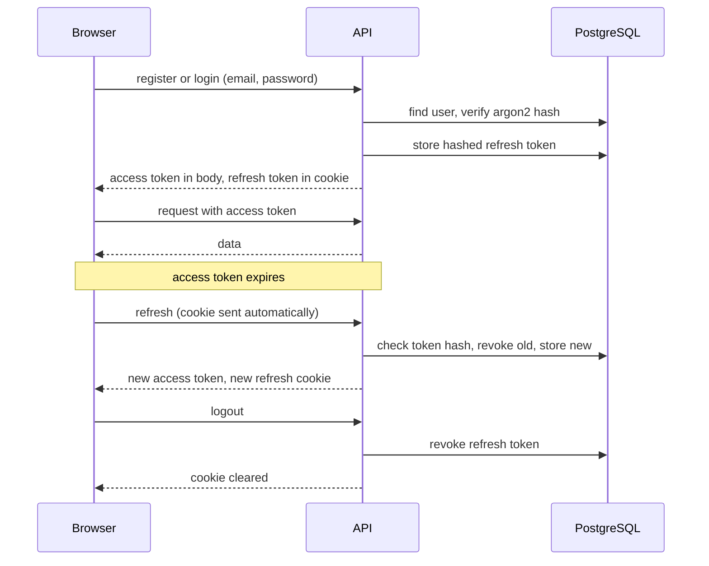
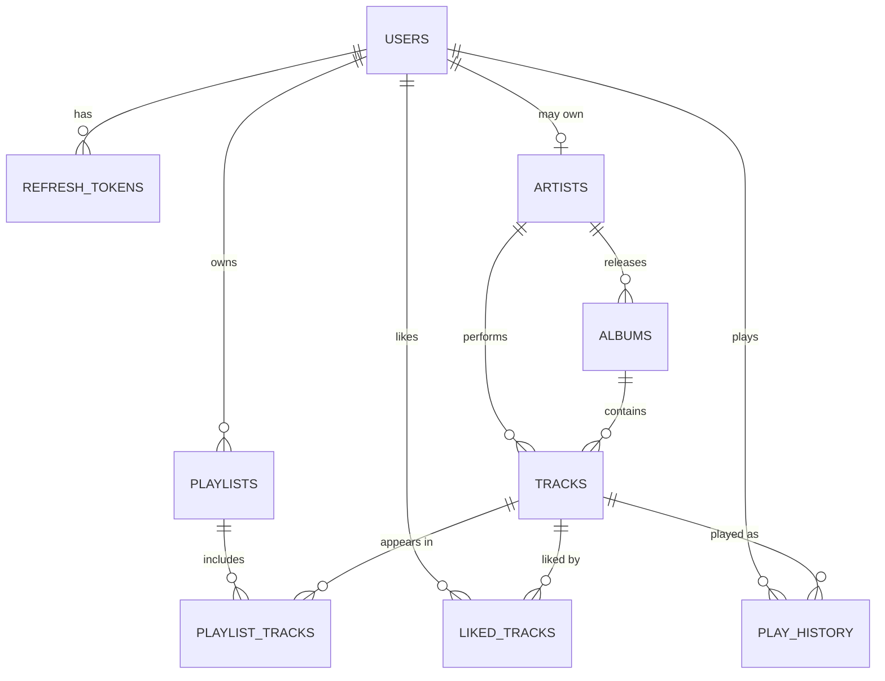
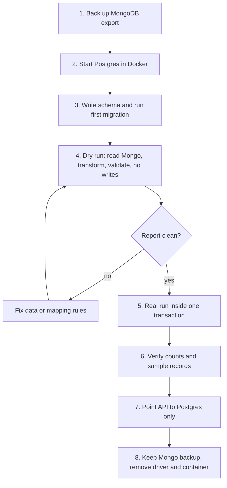
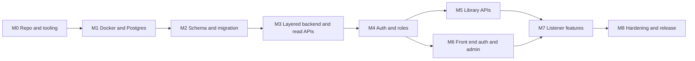

# Phase 0 Execution Plan

**Goal:** fix the foundations of the Spotify clone before any scaling work. This phase delivers four things:

1. Proper **authentication**
2. **Role-based access control (RBAC)**
3. The most important **missing Spotify web-player features**
4. A **migration from MongoDB to PostgreSQL**, running in **Docker**

> This is a planning document only. It contains no implementation code. Every task is written so you can turn it into a ticket and build it yourself.

> **Note on the feature list:** `open.spotify.com` is a JavaScript-rendered app, so its pages cannot be read as plain text. The feature list in section 3 is based on the known behaviour of the Spotify web player. Open the site next to your app while you work and adjust the list to what you see.

---

## 1. Outcomes and definition of done

Phase 0 is finished when **all** of these are true:

| # | Outcome | How you prove it |
| --- | --- | --- |
| 1 | The whole stack starts with one command (`docker compose up`) | Fresh clone on another machine works |
| 2 | All data lives in PostgreSQL; MongoDB is no longer used by the running app | Backend has no Mongo dependency left |
| 3 | Users can register, log in, log out, and stay logged in safely | Manual test plus automated tests |
| 4 | Roles `user`, `artist`, `admin` are enforced on the server for every protected route | Permission matrix test passes |
| 5 | Listener app has the Phase 0 feature set (section 3) | Feature checklist ticked |
| 6 | All list endpoints are paginated, and songs reference albums by ID | No endpoint returns an unbounded list |
| 7 | Backend is split into layers (route, controller, service, repository) | Code review against the rules in section 9 |
| 8 | CI runs lint, tests and build on every pull request | Green pipeline on `main` |
| 9 | Old data was migrated and verified with matching counts | Migration report saved |

---

## 2. Technology decisions for this phase

Decide these before starting. The recommendation is in bold; the alternative is acceptable.

| Concern | Recommendation | Alternative | Why |
| --- | --- | --- | --- |
| Database | **PostgreSQL 16** in Docker | none | Relational data, foreign keys, transactions |
| Data access | **Prisma** (schema file + migrations) | Drizzle, Knex, TypeORM | Readable schema, safe migrations, good for learning |
| Language (backend) | **Keep JavaScript, add JSDoc** or move to **TypeScript** | | TypeScript is better long term; do it now if you are willing to learn it, because it is cheaper to start than to convert later |
| Password hashing | **argon2** | bcrypt | Current best practice |
| Tokens | **Short-lived access token + rotating refresh token** | Server sessions | Works for web and later mobile |
| Validation | **Zod** | Joi | Same schemas can validate request bodies and generate types |
| Logging | **pino** | winston | Fast, structured |
| Testing | **Jest + Supertest** (backend), **Vitest + Testing Library** (frontend) | | Standard choices |
| DB admin tool | **pgAdmin** container (dev only) | DBeaver on host | Inspect data visually |
| Image and audio storage | **Keep Cloudinary for Phase 0** | | Storage moves to S3 in Phase 2; do not change two big things at once |
| Search (Phase 0) | **PostgreSQL text search with trigram index** | | Good enough until Phase 3 |

---

## 3. Feature gap analysis (what Spotify has that you do not)

### 3.1 Current state

Your listener app can: show albums and songs on the home page, open an album, play a song, and use play, pause, next, previous and seek. Shuffle, loop, volume, search, library and playlist blocks are layout only. There are no accounts.

### 3.2 Features to add in Phase 0

Priority: **P1 = must have**, **P2 = should have**, **P3 = stretch if time remains**.

| Area | Feature | Priority | Notes |
| --- | --- | --- | --- |
| **Accounts** | Sign up, log in, log out | P1 | Email and password |
| | Persistent login (refresh) | P1 | Survives page reload |
| | Profile page (display name, avatar) | P2 | Edit own profile |
| | Change password | P2 | Requires current password |
| | Forgot and reset password | P3 | Needs email sending; use a dev mail catcher container |
| **Player** | Working volume slider and mute | P1 | Currently layout only |
| | Working shuffle | P1 | |
| | Working repeat (off, all, one) | P1 | |
| | Play queue (view, reorder, add "play next", remove) | P1 | Spotify's queue panel |
| | Remember last track, volume and position | P2 | Stored per user |
| | Keyboard shortcuts (space, arrows) | P2 | |
| | Now-playing view with large cover | P3 | |
| **Browse** | Real album page: cover, title, artist, year, track numbers, durations, total time | P1 | |
| | **Artist** entity and artist page (top tracks, albums) | P1 | Songs currently have no artist |
| | Home sections: recently played, popular albums, new releases | P2 | Built from simple queries |
| | Loading skeletons, empty states, error states, 404 page | P1 | |
| **Search** | Search bar that finds songs, albums, artists | P1 | Debounced, tabbed results |
| | Recent searches | P3 | |
| **Library** | Like and unlike a song | P1 | Heart icon on rows and player |
| | "Liked Songs" page | P1 | |
| | Create, rename, delete playlist | P1 | |
| | Add and remove songs in a playlist | P1 | Also from a song's context menu |
| | Reorder songs in a playlist | P2 | |
| | Playlist cover and description | P2 | |
| | Public and private playlists | P2 | Private by default |
| | Left sidebar "Your Library" lists real playlists and liked songs | P1 | |
| | Follow artists | P3 | |
| **History** | Recently played list | P2 | Recorded after a track plays for a minimum time |
| **Interface** | Context menu on tracks (add to playlist, add to queue, like) | P2 | Right-click or three-dot menu |
| | Responsive layout for tablet and phone | P3 | |

### 3.3 Deliberately postponed

These exist on Spotify but belong to later phases, so do not build them now: podcasts, lyrics, collaborative playlists, personalised recommendations and Daily Mix, social features and friend activity, Spotify Connect, offline downloads, payments and Premium tiers, ads, DRM, mobile apps.

---

## 4. Roles and permissions

### 4.1 Roles

| Role | Who | How assigned |
| --- | --- | --- |
| **guest** | Not logged in | No account |
| **user** | Normal listener | Default on sign up |
| **artist** | Can manage their own artist profile, albums and songs | Granted by an admin |
| **admin** | Full catalog and user management | Created by a seed step, never by public sign up |

### 4.2 Permission matrix

| Action | guest | user | artist | admin |
| --- | --- | --- | --- | --- |
| Browse catalog (albums, artists, songs) | Yes | Yes | Yes | Yes |
| Search | Yes | Yes | Yes | Yes |
| Play a song | Preview only or blocked (decide, see section 14) | Yes | Yes | Yes |
| Like songs, create playlists, view history | No | Yes | Yes | Yes |
| Edit or delete **own** playlists | No | Yes | Yes | Yes |
| Edit or delete **anyone's** playlist | No | No | No | Yes |
| Create albums and songs for **own** artist profile | No | No | Yes | Yes |
| Edit or delete **own** albums and songs | No | No | Yes | Yes |
| Edit or delete **any** album, song or artist | No | No | No | Yes |
| List users, change user roles, disable users | No | No | No | Yes |

### 4.3 Enforcement rules

- The **server** is the only authority. Hiding a button in the UI is convenience, never security.
- Every protected route declares the roles it needs; one shared piece of middleware checks them.
- **Ownership checks** (for example "is this your playlist?") live in the service layer, not in the controller.
- An admin cannot remove their own admin role if they are the last admin.
- Return **401** when the user is not logged in and **403** when they are logged in but not allowed.
- Never return the password hash or token data in any response.

---

## 5. Authentication design

### 5.1 Token strategy

| Token | Lifetime | Where the browser keeps it | Purpose |
| --- | --- | --- | --- |
| Access token | About 15 minutes | In memory only (not localStorage) | Sent with every API request |
| Refresh token | About 7 to 30 days | `httpOnly`, `Secure`, `SameSite` cookie | Gets a new access token |

**Rotation:** every refresh issues a new refresh token and invalidates the old one. If an old token is used again, treat it as theft and revoke the whole token family for that user. Store only a **hash** of each refresh token in the database.

### 5.2 Flows



### 5.3 Rules and policies

- Password minimum length 8 (prefer 10); reject very common passwords; never log passwords.
- Normalise emails to lowercase before storing; unique constraint on email.
- Use the same error message for "unknown email" and "wrong password".
- Rate limit login, register and refresh (for example 5 login attempts per minute per IP and email); add temporary lockout after repeated failures.
- Set strict CORS to only your own front end origins, and enable secure headers.
- Add a `disabled` flag so an admin can block a user; check it on login and on refresh.
- Create the first admin through a **seed command** that reads email and password from environment variables.
- Email verification and password reset are P3; design the tables now (see section 6) so you can add them later.

---

## 6. Data model (PostgreSQL)

### 6.1 Relationships



### 6.2 Tables

Use UUIDs as primary keys. Every table gets `created_at`; mutable tables also get `updated_at`.

| Table | Key columns | Notes |
| --- | --- | --- |
| `users` | id, email (unique), password_hash, display_name, avatar_url, role, is_disabled, created_at, updated_at | Role is one of user, artist, admin |
| `refresh_tokens` | id, user_id, token_hash, family_id, expires_at, revoked_at, created_at | Index on user_id and token_hash |
| `artists` | id, name, bio, image_url, owner_user_id (nullable) | Owner links an artist account to a profile |
| `albums` | id, artist_id, title, description, bg_color, cover_url, released_at | Replaces name-based link |
| `tracks` | id, album_id, artist_id, title, description, track_number, duration_ms, audio_url, image_url | `audio_url` holds the current Cloudinary URL |
| `playlists` | id, owner_id, name, description, cover_url, is_public | Private by default |
| `playlist_tracks` | playlist_id, track_id, position, added_at | Composite primary key; position is ordered |
| `liked_tracks` | user_id, track_id, liked_at | Composite primary key |
| `play_history` | id, user_id, track_id, played_at | Index on user_id and played_at descending |
| `user_player_state` (P2) | user_id, last_track_id, volume, position_ms, repeat_mode, shuffle | One row per user |

### 6.3 Indexes and constraints to plan

- Unique: `users.email`; `(playlist_id, track_id)`; `(user_id, track_id)` on likes.
- Foreign keys everywhere, with deliberate delete behaviour: deleting a playlist removes its rows in `playlist_tracks`; deleting an album must be **blocked or soft-deleted** if it still has tracks (decide, see section 14).
- Indexes for the queries you know you will run: tracks by album ordered by track number; albums by artist; playlists by owner; likes by user ordered by time; history by user ordered by time.
- Search: enable the `pg_trgm` extension and add trigram indexes on track title, album title and artist name.

---

## 7. API surface for Phase 0

All routes are under `/v1`, return one consistent response shape, and paginate every list with a limit and a cursor. The legacy `/api/song` and `/api/album` routes are removed after both front ends are switched.

| Group | Endpoints | Access |
| --- | --- | --- |
| Auth | register, login, refresh, logout, logout-all | Public (logout needs login) |
| Me | get profile, update profile, change password, get and update player state | user and above |
| Catalog read | list and get albums, artists, tracks; artist's albums and top tracks; album's tracks | Public |
| Search | one search endpoint with a type filter | Public |
| Library | like, unlike, list liked tracks | user and above |
| Playlists | create, list mine, get, update, delete, add track, remove track, reorder tracks | user and above (ownership enforced) |
| History | record play, list recent | user and above |
| Catalog write | create, update, delete albums, tracks, artists | artist (own) and admin |
| Admin | list users, change role, disable and enable user | admin only |
| System | health and readiness | Public |

**Response rules:** use one envelope for success and for errors, use real booleans (fix the current mix of boolean and string success values), and use the same error codes for the same problems across all routes.

---

## 8. Docker plan

### 8.1 Services

| Service | Image or build | Port (host) | Purpose | Profile |
| --- | --- | --- | --- | --- |
| `postgres` | postgres 16 | 5432 | Main database | default |
| `pgadmin` | pgadmin4 | 5050 | Database UI | dev only |
| `mailpit` | mailpit | 8025 | Catches emails (P3 reset flow) | dev only |
| `api` | built from backend Dockerfile | 4000 | Express API | default |
| `web` | built from listener Dockerfile | 5173 | Listener UI | optional |
| `admin` | built from admin Dockerfile | 5174 | Admin UI | optional |
| `mongo` | mongo (temporary) | 27017 | Only for the migration step | migration only |

Run the front ends on your host with their dev servers while developing, and containerise them later; the API and database must be containerised from day one.

### 8.2 Requirements

- A **named volume** for Postgres data so data survives `docker compose down`.
- A **healthcheck** on Postgres; the API waits until the database is healthy.
- All configuration through **environment variables**; commit an `.env.example`, never the real `.env`.
- Separate environment files or profiles for development and test; tests use a separate database.
- A **multi-stage Dockerfile** for the API (build stage, small runtime stage, non-root user).
- A `.dockerignore` so `node_modules` and secrets never enter images.
- Hot reload in development by mounting the source folder.
- A short `Makefile` or npm scripts for: start, stop, reset database, run migrations, seed, run tests.

### 8.3 Environment variables to define (names only)

Database URL, database user, password and name; access token secret and lifetime; refresh token secret and lifetime; cookie settings; allowed front end origins; Cloudinary name, key and secret; seed admin email and password; log level; port.

---

## 9. Backend restructure (layered)

### 9.1 Target folder layout

```text
backend/
├── prisma/                  schema and migrations
├── scripts/                 seed, mongo-to-postgres migration, verification
└── src/
    ├── config/              validated environment, cloudinary
    ├── shared/              logger, errors, response helpers, pagination, validators
    ├── middleware/          authenticate, authorize, rate limit, error handler, upload
    └── modules/
        ├── auth/
        ├── users/
        ├── artists/
        ├── albums/
        ├── tracks/
        ├── playlists/
        ├── library/         likes
        ├── history/
        ├── search/
        └── admin/
            (each module: routes, controller, service, repository, schemas, tests)
```

### 9.2 Layer rules (check these in every code review)

| Layer | May do | Must not do |
| --- | --- | --- |
| Route | Map URL and method to a controller, attach middleware | Contain logic |
| Controller | Read the request, call one service method, shape the response | Touch the database, hold business rules |
| Service | Business rules, ownership and role checks, orchestration | Know about HTTP objects or SQL |
| Repository | All database queries | Make business decisions |
| Schemas | Validate input and output shapes | Hold state |

Modules may call each other **only through service functions**, never by reading another module's tables directly.

---

## 10. MongoDB to PostgreSQL migration plan

### 10.1 Current data and how it maps

| Mongo | PostgreSQL | Transformation |
| --- | --- | --- |
| `album` collection (name, desc, bgColor, image) | `albums` | New UUID; `image` becomes `cover_url`; needs an artist |
| `song` collection (name, desc, album name, image, file, duration "m:s") | `tracks` | Resolve the album **name** to an album ID; `file` becomes `audio_url`; duration text converts to milliseconds |
| none | `artists` | Your old data has **no artist**; see below |

### 10.2 Decisions needed for missing data

- **Artist:** create one placeholder artist (for example "Unknown Artist") and attach all old albums to it, then fix the real artists through the admin screen. Alternatively, provide a small mapping file you write by hand.
- **Song with an album name that matches nothing, or matches two albums:** list these in a report, do not guess. Fix them by hand or assign to a placeholder "Singles" album.
- **Old Mongo IDs:** keep them in a temporary `legacy_mongo_id` column during migration so you can trace and verify, then drop the column in Phase 1.

### 10.3 Steps



1. **Back up:** export both collections and keep the files outside the repository.
2. **Stand up Postgres** with Docker and confirm you can connect with pgAdmin.
3. **Model the schema** in the Prisma schema file and create the first migration.
4. **Dry run:** a one-off script reads Mongo, applies the mapping rules and prints a report (counts, orphan songs, duplicate album names, bad durations). It writes nothing.
5. **Real run:** the same script inserts in dependency order (artists, albums, tracks) inside a **single transaction**, so a failure leaves the database untouched. Make the script **re-runnable** (clear target tables first in dev, or use upserts keyed by the legacy ID).
6. **Verify:** compare counts (albums in equals albums out, songs in equals songs out), spot-check ten random records, confirm every track has a valid album and artist, and open the app against the new data.
7. **Cut over:** switch the API to Postgres only; delete Mongoose models, the Mongo connection file and the dependency.
8. **Keep the backup** until Phase 0 is signed off, then archive it.

### 10.4 Rollback

Because the Mongo export is untouched and the migration is re-runnable, rollback means: revert the branch, point the app back to the old API, and drop the Postgres volume. Do not delete anything from Mongo until the end of Phase 0.

---

## 11. Frontend changes

### 11.1 Listener app

| Area | Work |
| --- | --- |
| Structure | Move all API calls into one `services` layer; use a server-state library for caching and pagination; keep `PlayerContext` only for playback |
| Auth | Auth context holding the user and in-memory access token; automatic refresh on 401; protected routes; redirect after login |
| New pages | Login, sign up, search, liked songs, playlist, artist, profile, 404 |
| Player | Wire up volume, mute, shuffle, repeat, queue panel, like button, keyboard shortcuts |
| Library sidebar | Real playlists and liked songs from the API; "create playlist" button |
| UX | Skeleton loaders, empty states, error messages, toasts, disabled states for guests with a prompt to log in |
| Pagination | Infinite scroll or "load more" on lists |

### 11.2 Admin app

| Area | Work |
| --- | --- |
| Auth | Login screen; only `admin` and `artist` roles may enter; hide menu items by role |
| Catalog | Album and song forms use dropdowns that store **IDs**; add artist management |
| Users (admin only) | Table of users, change role, disable and enable |
| Quality | Server-side pagination and search in list pages; confirmation dialogs on delete |

---

## 12. Work breakdown

### 12.1 Dependency order



### 12.2 Milestones and tasks

Estimates assume part-time study (about 2 hours per day). Adjust to your pace.

**M0: Repo and tooling (about 1 day)**
- [ ] Create a working branch strategy (`main`, short-lived feature branches, pull requests even if you work alone)
- [ ] Add linting and formatting, a commit message convention, and a `.gitignore` review
- [ ] Add `.env.example` files and a README section describing setup
- [ ] Back up the current Mongo data

**M1: Docker and Postgres (about 2 days)**
- [ ] Write the compose file with Postgres, pgAdmin and the API service
- [ ] Add healthchecks, a named volume and the multi-stage API Dockerfile
- [ ] Prove: `docker compose up` gives a running API that connects to Postgres
- [ ] Add scripts for reset, migrate and seed

**M2: Schema and data migration (about 3 days)**
- [ ] Finalise the table design in section 6 and review it once
- [ ] Create the Prisma schema and the first migration
- [ ] Write the dry-run script and read the report
- [ ] Decide the artist and orphan-song rules (section 10.2)
- [ ] Run the real migration and the verification checklist
- [ ] Write a short migration report with counts

**M3: Layered backend and read APIs (about 4 days)**
- [ ] Add the shared pieces: environment validation, logger, error classes, response envelope, pagination helper, validators
- [ ] Rebuild albums, artists and tracks as modules following the layer rules
- [ ] Implement the `/v1` read endpoints with pagination
- [ ] Add the search endpoint with trigram indexes
- [ ] Add health and readiness endpoints
- [ ] Write the first service and integration tests

**M4: Authentication and roles (about 5 days)**
- [ ] Implement register, login, refresh with rotation, logout and logout-all
- [ ] Implement the authenticate and authorize middleware
- [ ] Add rate limiting and secure headers
- [ ] Implement the admin seed command
- [ ] Protect catalog write endpoints; add ownership checks for artists
- [ ] Implement the admin user-management endpoints
- [ ] Write the permission-matrix test: every route against every role

**M5: Library APIs (about 4 days)**
- [ ] Likes: like, unlike, list
- [ ] Playlists: full create, read, update, delete and track management with ordering
- [ ] History: record and list recent plays
- [ ] Player state endpoints (P2)
- [ ] Tests for ownership rules (a user cannot edit another user's playlist)

**M6: Front end authentication and admin app (about 4 days)**
- [ ] Listener: auth context, login and sign up pages, silent refresh, protected routes
- [ ] Admin: login, role gate, role-aware menu, ID-based dropdowns, artist and user management pages
- [ ] Switch both apps to the `/v1` API

**M7: Listener features (about 8 days)**
- [ ] Real album page and artist page
- [ ] Search page
- [ ] Likes and Liked Songs page
- [ ] Playlists UI and library sidebar
- [ ] Player: volume, shuffle, repeat, queue panel, keyboard shortcuts
- [ ] Recently played on home; loading, empty and error states; 404
- [ ] P2 and P3 items as time allows

**M8: Hardening and release (about 3 days)**
- [ ] Add GitHub Actions: lint, test, build, and a Docker image build
- [ ] Run a first baseline load test and save the numbers
- [ ] Security checklist pass (section 13)
- [ ] Remove legacy routes, Mongo code and dependencies
- [ ] Update README and ARCHITECTURE documents
- [ ] Tag the release `v0.1.0` and write short release notes

**Total:** about 34 working days, or roughly 7 weeks at a steady part-time pace. Milestones M5 and M6 can overlap.

---

## 13. Testing and quality plan

| Level | What | Target |
| --- | --- | --- |
| Unit | Services (business rules), validators, pagination helper | Fast, no database |
| Integration | Routes against a real test Postgres container | Every endpoint, success and failure |
| Permission matrix | Every protected endpoint tried as guest, user, artist and admin | Table-driven, must be 100% |
| Migration | Dry run and verification report | Counts match, no orphans |
| Front end | Component tests for auth forms, player controls, playlist actions | Key flows only |
| End to end (P2) | Register, search, play, like, create playlist | One happy path with Playwright |
| Load (baseline) | Browse and search endpoints at moderate load | Save p95 and error rate |

**Security checklist before release**
- [ ] No secrets in the repository or in Docker images
- [ ] Passwords hashed, never logged; hash never returned
- [ ] Refresh tokens stored hashed; rotation and reuse detection tested
- [ ] Access token not stored in localStorage
- [ ] CORS limited to known origins; secure headers on
- [ ] Rate limits on auth routes
- [ ] File upload checks type and size
- [ ] Dependency audit has no high severity issues
- [ ] Every write route requires the correct role
- [ ] Error responses do not leak stack traces

---

## 14. Decisions to make before you start

Answer these first; each one changes the plan slightly.

| # | Question | Options | Recommendation |
| --- | --- | --- | --- |
| 1 | TypeScript or JavaScript for the backend? | TypeScript or JavaScript | TypeScript, if you are willing to learn it now |
| 2 | Can guests play music? | Block, or 30-second preview, or full | Require login to play; it makes the auth flow meaningful |
| 3 | Deleting an album that has tracks | Block, cascade, or soft delete | Block with a clear message |
| 4 | Merge admin app into the listener app? | Keep separate or merge by role | Keep separate for now; revisit in Phase 1 |
| 5 | Who becomes an `artist`? | Admin grants role, or self-service request | Admin grants for Phase 0 |
| 6 | Include password reset in Phase 0? | Yes or later | Later (P3) |
| 7 | Old songs have no artist | Placeholder or hand-written mapping | Placeholder, then fix in admin |

---

## 15. Risks

| Risk | Likelihood | Mitigation |
| --- | --- | --- |
| Scope grows with every Spotify feature you notice | High | Stick to the priority table; write extra ideas in a backlog file |
| Migration loses or mislinks data | Medium | Dry run, single transaction, count verification, untouched backup |
| Auth bugs create security holes | Medium | Permission-matrix tests, review the token rotation logic twice, avoid inventing custom crypto |
| Docker networking and volume confusion | Medium | Document the commands, keep a reset script |
| Doing everything at once | High | Finish and merge each milestone before starting the next |

---

## 16. Deliverables checklist

- [ ] Compose file, Dockerfiles, `.env.example`
- [ ] Prisma schema and migrations
- [ ] Migration scripts plus the saved migration report
- [ ] Layered backend with `/v1` API and OpenAPI documentation
- [ ] Auth, refresh rotation, RBAC and seed admin
- [ ] Updated listener app with the P1 features (and as many P2 as possible)
- [ ] Updated admin app with login, role gate, artists and users
- [ ] Test suites and a green CI pipeline
- [ ] Baseline load test results
- [ ] Updated README and ARCHITECTURE documents
- [ ] Release tag `v0.1.0`

When this checklist is complete, you are ready for **Phase 1**: the modular monolith with Redis caching and a hardened data model.
