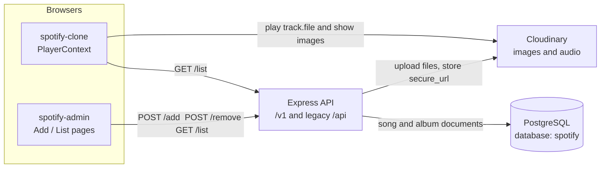
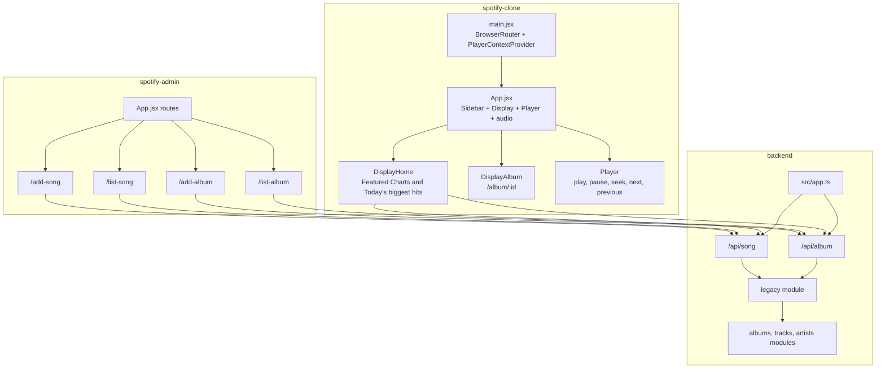
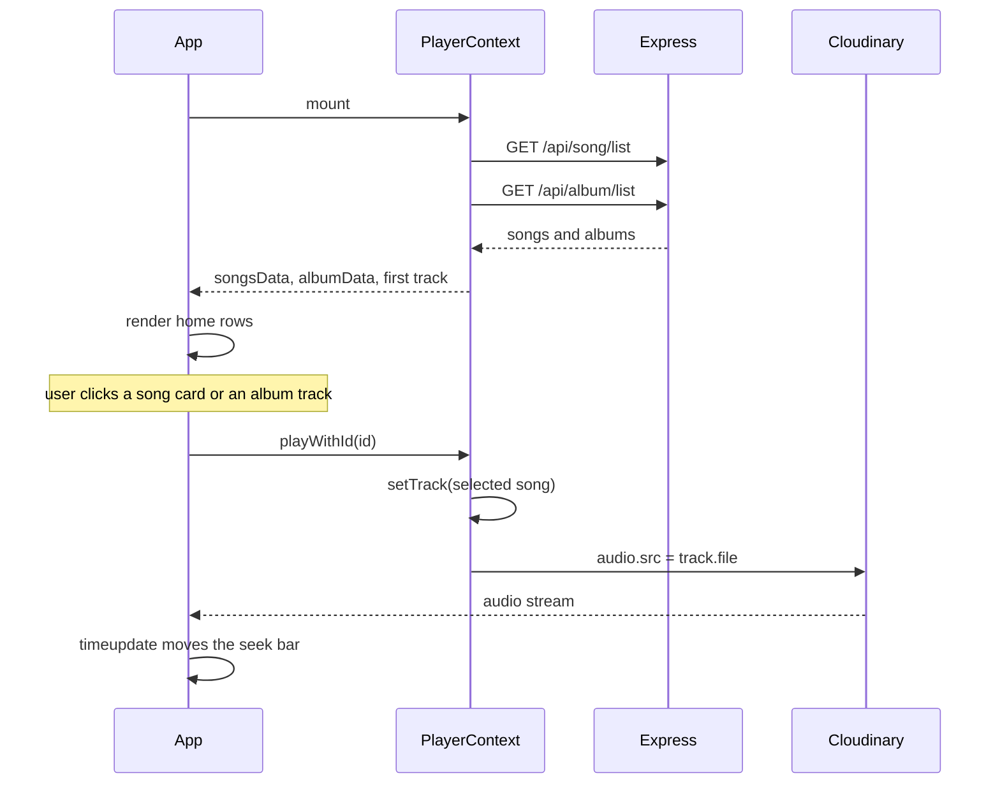
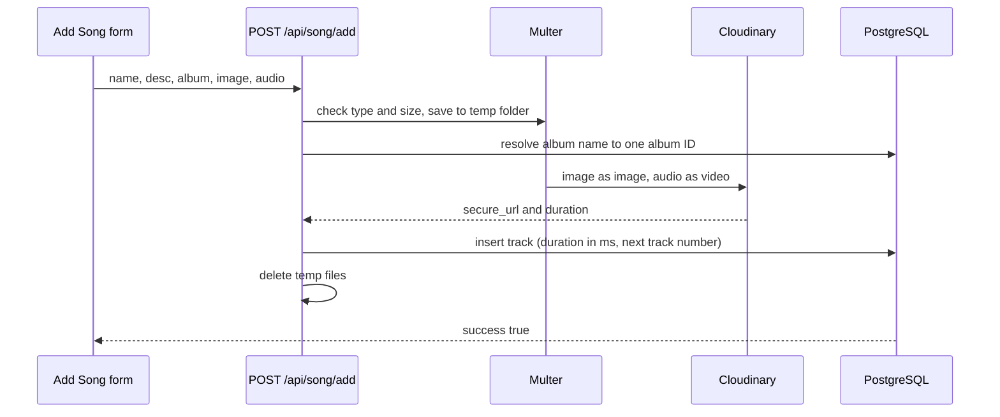

# Spotify Clone

A three-part music app. An admin panel uploads albums and songs, an Express API stores the metadata in PostgreSQL and the files in Cloudinary, and a listener UI plays that catalog.

Both front ends currently call the hosted API at `https://spotify-clone-backend-rctz.onrender.com`, through the legacy `/api` routes. The new `/v1` API is described below; the front ends switch to it in Phase 0 milestone M6.

Architecture diagrams and data flow live in [ARCHITECTURE.md](ARCHITECTURE.md). The plan for growing this into a million-user system is in [SCALING-PLAN.md](SCALING-PLAN.md), and the current work is tracked in [PHASE_0_PLAN.md](PHASE_0_PLAN.md).

## Repository layout

```text
Spotify-clone/
├── spotify-clone/     Listener UI (React + Vite). Home, album pages, player.
├── spotify-admin/     Admin UI (React + Vite). Add and remove albums and songs.
├── backend/           Express API (TypeScript). PostgreSQL via Prisma, Cloudinary uploads.
├── docker/            Init files for the Postgres and pgAdmin containers.
├── docs/              Migration report and other generated records.
└── docker-compose.yml Postgres, API, and dev tools.
```

| App | Stack | Default command | Role |
| --- | --- | --- | --- |
| `spotify-clone` | React 18, React Router 6, Axios, Tailwind | `npm run dev` (port 5173) | Browse and play |
| `spotify-admin` | React 18, React Router 6, Axios, MUI, Toastify, Tailwind | `npm run dev` (port 5173) | Manage the catalog |
| `backend` | Express 5, TypeScript, Prisma, PostgreSQL 16, Zod, pino, Multer, Cloudinary | `npm run dev` from the root, through Docker (port 4000) | Persist metadata and files |

Run the admin app on another port so it does not collide with the listener: `npm run dev -- --port 5174`.

## System architecture



In the database a track references its album by ID. The legacy `/api` responses still give each song an `album` field holding the album's **name**, because the listener's album page keeps songs where `item.album === album.name`.



## How the listener works

`PlayerContext` is the single source of playback state. On mount it loads the catalog, then the rest of the UI reads that context.



1. `main.jsx` wraps the app in `BrowserRouter` and `PlayerContextProvider`.
2. The provider calls `GET /api/song/list` and `GET /api/album/list`, stores both arrays, and selects the first song as `track`.
3. `App` stays on a loading message until `songsData` has items. It then renders the sidebar, the main display (95% height), and the bottom player. A hidden `<audio>` element holds `track.file`.
4. **Home (`/`)** shows albums under “Featured Charts” and songs under “Today's biggest hits”.
5. Clicking an album navigates to `/album/:id`. `Display` paints a gradient from that album’s `bgColor` into `#121212`. The page lists songs whose `album` field matches the album name. Clicking a row calls `playWithId`.
6. Changing `track` sets `audio.src` and calls `play()`. Play and pause toggle the element. Next and previous walk `songsData` by index. Clicking the seek bar sets `currentTime` from the click position. A `timeupdate` listener writes elapsed time and the green progress width.

The sidebar Home control returns to `/`. Search, library, playlist, and podcast blocks are layout only. Shuffle, loop, and the volume icons in the player are layout only.

## How the admin works

The admin shell is a sidebar plus four routes. Every write sends `multipart/form-data`. Toasts report success and failure.



| Route | Page | What it does |
| --- | --- | --- |
| `/add-album` | `AddAlbum` | Name, description, background color, cover image. `POST /api/album/add`. |
| `/list-album` | `ListAlbum` | Table of albums. Delete calls `POST /api/album/remove` with `{ id }`. |
| `/add-song` | `AddSong` | Name, description, album name (loaded from `/api/album/list`), cover, audio file. `POST /api/song/add`. |
| `/list-song` | `ListSong` | Table of songs. Delete calls `POST /api/song/remove` with `{ id }`. |

Album color is a hex value. The listener uses it only as the album-page gradient.

## How the API works

`backend/src/app.ts` adds request logging (pino), secure headers (helmet), CORS limited to `CORS_ORIGINS`, and JSON body limits, then mounts `/v1` and the legacy `/api` routers. Every response uses one envelope:

```json
{ "success": true, "data": ..., "meta": { "limit": 20, "nextCursor": "..." } }
{ "success": false, "error": { "code": "NOT_FOUND", "message": "Album not found" } }
```

### `/v1` (read API, public)

Every list takes `limit` (1 to 100, default 20) and `cursor`; pass `meta.nextCursor` back to get the next page.

| Method | Path | Result |
| --- | --- | --- |
| `GET` | `/v1/health` | Liveness; does not touch the database |
| `GET` | `/v1/ready` | Readiness; 503 if PostgreSQL is unreachable |
| `GET` | `/v1/albums` | Albums, newest first, each with its artist |
| `GET` | `/v1/albums/:id` | Album plus `trackCount` and `totalDurationMs` |
| `GET` | `/v1/albums/:id/tracks` | Tracks in track-number order |
| `GET` | `/v1/artists`, `/v1/artists/:id` | Artists |
| `GET` | `/v1/artists/:id/albums` | Albums, newest release first |
| `GET` | `/v1/artists/:id/top-tracks?limit=10` | Most played tracks |
| `GET` | `/v1/tracks`, `/v1/tracks/:id` | Tracks with album and artist |
| `GET` | `/v1/search?q=&type=all\|track\|album\|artist` | Substring and typo-tolerant search (PostgreSQL trigram indexes). One paged section per type; `cursor` needs a single `type`. |

Write endpoints, sign-in, and roles arrive in milestone M4.

### Legacy `/api` (current front ends)

These keep the request and response shapes the two React apps already use, now backed by PostgreSQL. They are removed in M6.

| Method | Path | Body | Result |
| --- | --- | --- | --- |
| `GET` | `/api/song/list` | none | `{ success: true, songs: [{ _id, name, desc, album, image, file, duration }] }`, oldest first, at most 500 |
| `POST` | `/api/song/add` | Fields `name`, `desc`, `album` (album **name**). Files `image` (5 MB), `audio` (50 MB). | Uploads to Cloudinary and appends the track to the album. 404 if no album has that name, 409 if several do. |
| `POST` | `/api/song/remove` | `{ id }` | Deletes the track |
| `GET` | `/api/album/list` | none | `{ success: true, album: [{ _id, name, desc, bgColor, image }] }` |
| `POST` | `/api/album/add` | Fields `name`, `desc`, `bgColor`. File `image`. | New album under the placeholder artist "Unknown Artist" |
| `POST` | `/api/album/remove` | `{ id }` | Deletes the album; **409 `ALBUM_HAS_TRACKS`** if it still has tracks |

`_id` values are now UUIDs. `success` is always a real boolean. Removing a song or album does not delete the Cloudinary asset.

### Data model

PostgreSQL tables are defined in [`backend/prisma/schema.prisma`](backend/prisma/schema.prisma): `users`, `refresh_tokens`, `password_reset_tokens`, `artists`, `albums`, `tracks`, `playlists`, `playlist_tracks`, `liked_tracks`, `play_history`, `user_player_state`. Only the catalog tables are used by the API so far; the others are ready for M4 and M5.

## Backend folders

```text
backend/
├── prisma/             schema.prisma and migrations
├── scripts/            backup-legacy-api, migrate-mongo (dry run, apply, verify)
├── test/               integration tests against the spotify_test database
└── src/
    ├── server.ts       starts the HTTP server, graceful shutdown
    ├── app.ts          middleware and routers
    ├── config/         validated environment, Cloudinary
    ├── shared/         db client, logger, errors, response envelope, pagination, validation
    ├── middleware/     error handler, uploads
    └── modules/        health, artists, albums, tracks, search, legacy
                        each: routes -> controller -> service -> repository
```

Layer rules (from the Phase 0 plan): routes only wire URLs; controllers read the request and call one service method; services hold business rules; only repositories touch the database. Modules use each other only through services. ESLint blocks database imports in controllers and services.

## Run it locally

You need Docker Desktop and Node 22 or newer.

```bash
# 1. Configuration (both files are git-ignored)
cp .env.example .env                    # database passwords for docker compose; optional
cp backend/.env.example backend/.env    # Cloudinary keys, CORS origins

# 2. Postgres + API, with hot reload: edits in backend/src restart the server
npm run dev              # or: npm start, to run in the background
# API at http://localhost:4000/v1/health

# 3. Optional tools: pgAdmin at http://localhost:5050, Mailpit at http://localhost:8025
npm run dev:tools

# 4. Front ends, in their own terminals
cd spotify-clone && npm install && npm run dev                    # http://localhost:5173
cd spotify-admin && npm install && npm run dev -- --port 5174     # http://localhost:5174
```

To make the front ends use your local API, set `url` in `spotify-clone/src/context/PlayerContext.jsx` and the exported `url` in `spotify-admin/src/App.jsx` to `http://localhost:4000`.

### Useful commands (from the repository root)

| Command | What it does |
| --- | --- |
| `npm run stop` | Stop the containers; data is kept in the `pgdata` volume |
| `npm run db:wipe` | Stop and delete all volumes (database starts empty) |
| `npm run db:migrate` | Create and apply a new migration after editing `schema.prisma` |
| `npm run db:reset` | Drop and re-create the database from migrations |
| `npm run logs` | Follow API logs |
| `npm test` | Unit and integration tests; needs the `postgres` container running |
| `npm run lint` | ESLint for the backend |

### Loading the old MongoDB catalog

```bash
cd backend
npm run backup:legacy                                      # export from the hosted API into backups/
npm run migrate:mongo -- --file ../backups/legacy-<date>.json            # dry run and report
npm run migrate:mongo -- --file ../backups/legacy-<date>.json --apply    # one transaction, then verify
```

With direct database access, set `MONGODB_URI` in `backend/.env` and use `--source mongo` instead of `--file`. Reports are saved to `backups/`. See [docs/migration-report-phase0.md](docs/migration-report-phase0.md) for the last run.

### Conventions

- Branches: `master` stays deployable; work happens on short-lived `feature/...` branches merged through pull requests.
- Commits follow [Conventional Commits](https://www.conventionalcommits.org): `feat(scope): ...`, `fix: ...`, `chore: ...`, `docs: ...`.
- Formatting: Prettier (`npm run format`), settings in `.prettierrc.json`.
