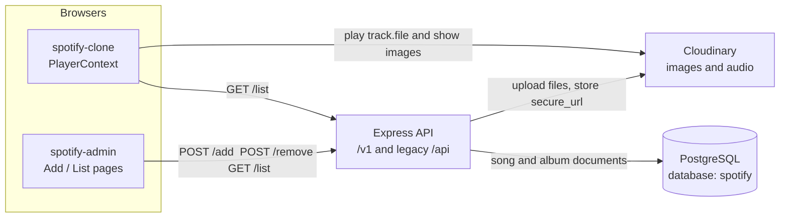
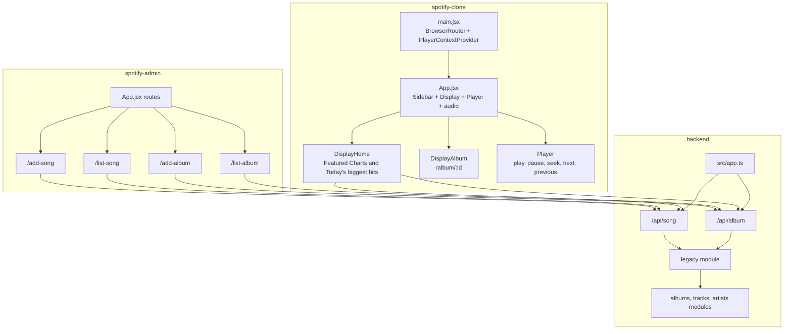
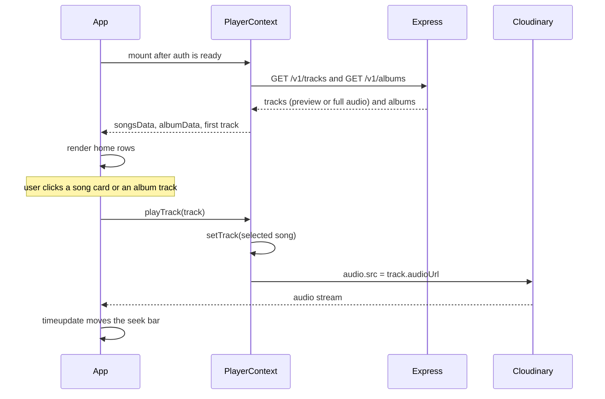
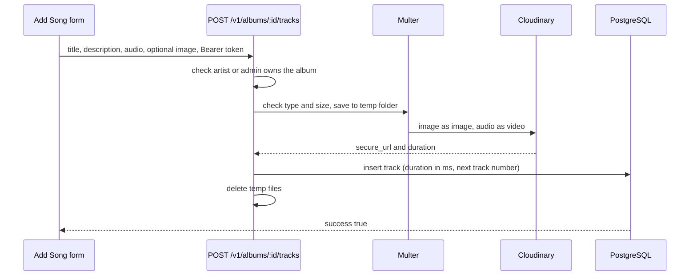

# Spotify Clone

A three-part music app. An admin panel uploads albums and songs, an Express API stores the metadata in PostgreSQL and the files in Cloudinary, and a listener UI plays that catalog.

Both front ends currently call the hosted API at `https://spotify-clone-backend-rctz.onrender.com`, through the legacy `/api` routes. The new `/v1` API is described below; the front ends switch to it in Phase 0 milestone M6.

Architecture diagrams and data flow live in [ARCHITECTURE.md](ARCHITECTURE.md). The plan for growing this into a million-user system is in [SCALING-PLAN.md](SCALING-PLAN.md), and the current work is tracked in [PHASE_0_PLAN.md](PHASE_0_PLAN.md).

## Repository layout

```text
Spotify-clone/
├── spotify-clone/     Listener UI (React + Vite). Home, album pages, player.
├── spotify-admin/     Admin UI (React + Vite). Add and remove albums and songs.
├── backend/           Express API (TypeScript). PostgreSQL via Prisma, Cloudinary uploads.
├── docker/            Init files for the Postgres and pgAdmin containers.
├── docs/              Migration report and other generated records.
└── docker-compose.yml Postgres, API, and dev tools.
```

| App | Stack | Default command | Role |
| --- | --- | --- | --- |
| `spotify-clone` | React 18, React Router 6, Axios, Tailwind | `npm run dev` (port 5173) | Browse and play |
| `spotify-admin` | React 18, React Router 6, Axios, MUI, Toastify, Tailwind | `npm run dev` (port 5173) | Manage the catalog |
| `backend` | Express 5, TypeScript, Prisma, PostgreSQL 16, Zod, pino, Multer, Cloudinary | `npm run dev` from the root, through Docker (port 4000) | Persist metadata and files |

Run the admin app on another port so it does not collide with the listener: `npm run dev -- --port 5174`.

## System architecture



In the database a track references its album by ID. The legacy `/api` responses still give each song an `album` field holding the album's **name**, because the listener's album page keeps songs where `item.album === album.name`.



## How the listener works

`AuthContext` holds the signed-in user. The access token stays in memory; a silent `POST /v1/auth/refresh` on load (and again after a 401) uses the httpOnly cookie. `PlayerContext` is only for playback: it loads `/v1` albums and tracks after auth is ready so guests get preview URLs and signed-in listeners get the full track.



1. `main.jsx` wraps the app in `BrowserRouter`, `AuthProvider` and `PlayerContextProvider`.
2. Auth restores the session with `POST /v1/auth/refresh`. The catalog then loads from `/v1`. Guests hear a 30-second preview when Cloudinary can trim the file.
3. `/login` and `/signup` create a session. `/profile` is signed-in only. The navbar shows Log in / Sign up or the account initial and Log out.
4. **Home (`/`)** shows albums under “Featured Charts” and songs under “Today's biggest hits”.
5. `/album/:id` loads that album and its tracks from `/v1`. The display paints a gradient from `bgColor`. A row click plays that track.
6. Changing `track` sets `audio.src` to `audioUrl` and calls `play()`. Next and previous walk the home track list. The seek bar still sets `currentTime`.

Search, library, playlist, and player extras (shuffle, volume, likes) are still layout only until M7.

## How the admin works

The admin app signs in against `/v1/auth`. Only `artist` and `admin` accounts get past the gate. Artists see catalog pages for their own profile; admins also see artist and user management. Writes use `/v1` and album/artist **IDs** in the dropdowns.



| Route | Page | What it does |
| --- | --- | --- |
| `/add-album` | `AddAlbum` | Title, description, color, cover. Admins pick an artist ID. `POST /v1/albums`. |
| `/list-album` | `ListAlbum` | Paged albums. Delete is `DELETE /v1/albums/:id` after confirm. |
| `/add-song` | `AddSong` | Title, description, album **ID**, audio, optional cover. `POST /v1/albums/:id/tracks`. |
| `/list-song` | `ListSong` | Paged tracks. Delete is `DELETE /v1/tracks/:id` after confirm. |
| `/add-artist`, `/list-artist` | admin only | Create and list artists |
| `/users` | admin only | Search users, change role (optional artist ID), disable or enable |

Album color is a hex value. The listener uses it only as the album-page gradient.

## How the API works

`backend/src/app.ts` adds request logging (pino), secure headers (helmet), CORS limited to `CORS_ORIGINS`, JSON body limits and cookie parsing, then mounts `/v1` and the legacy `/api` routers. Every response uses one envelope:

```json
{ "success": true, "data": ..., "meta": { "limit": 20, "nextCursor": "..." } }
{ "success": false, "error": { "code": "NOT_FOUND", "message": "Album not found" } }
```

### Accounts and sign-in

Roles are `user` (listener), `artist` (manages one linked artist profile) and `admin`. Anyone can register as a `user`; only admins change roles.

- **Access token:** a 15-minute JWT returned in the response body. Send it as `Authorization: Bearer <token>`. Keep it in memory, not in `localStorage`.
- **Refresh token:** an httpOnly cookie named `refresh_token`, sent only to `/v1/auth/*`. Each refresh replaces it. Presenting an old one again is treated as theft: every session descended from that sign-in is ended.
- The role and the disabled flag are read from the database on every request, so admin changes apply immediately.
- Passwords are hashed with argon2id: 10 to 128 characters, not a common password, and not containing your email name or display name.
- Rate limits: 5 login attempts per minute per email and IP, a 15-minute lockout after 10 failures for one email, 10 registrations per hour per IP, and 30 refreshes per minute per IP. The counters are in memory, so they reset on restart.

| Method | Path | Who | Result |
| --- | --- | --- | --- |
| `POST` | `/v1/auth/register` | anyone | `{ email, password, displayName }`; 201 with `{ user, accessToken, expiresIn }` and the cookie |
| `POST` | `/v1/auth/login` | anyone | `{ email, password }`; same response. 401 `INVALID_CREDENTIALS`, 403 `ACCOUNT_DISABLED`, 429 `RATE_LIMITED` |
| `POST` | `/v1/auth/refresh` | cookie | New access token and rotated cookie; 401 `REFRESH_TOKEN_INVALID` or `REFRESH_TOKEN_REUSED` |
| `POST` | `/v1/auth/logout` | cookie | Ends this sign-in; 204 |
| `POST` | `/v1/auth/logout-all` | signed in | Ends every session; 204 |
| `GET`, `PATCH` | `/v1/me` | signed in | Profile; `PATCH` takes `displayName`, `avatarUrl` (https) |
| `POST` | `/v1/me/password` | signed in | `{ currentPassword, newPassword }`; signs out other devices and returns a fresh session |

The cookie routes reject requests whose `Origin` is not in `CORS_ORIGINS`. Create the first admin with `npm run db:seed` (see below).

### `/v1` catalog

Every list takes `limit` (1 to 100, default 20) and `cursor`; pass `meta.nextCursor` back to get the next page.

Reads are public. Track responses depend on who asks. Signed-in listeners get the full `audioUrl`. Guests get a 30-second Cloudinary preview URL with `isPreview: true` and `previewMs`, or `audioUrl: null` when the file is not on Cloudinary and cannot be trimmed. The full file is still public on Cloudinary, so this is a product limit rather than copy protection.

| Method | Path | Result |
| --- | --- | --- |
| `GET` | `/v1/health` | Liveness; does not touch the database |
| `GET` | `/v1/ready` | Readiness; 503 if PostgreSQL is unreachable |
| `GET` | `/v1/albums` | Albums, newest first, each with its artist |
| `GET` | `/v1/albums/:id` | Album plus `trackCount` and `totalDurationMs` |
| `GET` | `/v1/albums/:id/tracks` | Tracks in track-number order |
| `GET` | `/v1/artists`, `/v1/artists/:id` | Artists |
| `GET` | `/v1/artists/:id/albums` | Albums, newest release first |
| `GET` | `/v1/artists/:id/top-tracks?limit=10` | Most played tracks |
| `GET` | `/v1/tracks`, `/v1/tracks/:id` | Tracks with album and artist |
| `GET` | `/v1/search?q=&type=all\|track\|album\|artist` | Substring and typo-tolerant search (PostgreSQL trigram indexes). One paged section per type; `cursor` needs a single `type`. |

Writes need a signed-in artist or admin. Artists can change only their own artist profile and its albums and tracks; admins can change anything. Uploads are multipart (`cover` and `image` up to 5 MB, `audio` up to 50 MB).

| Method | Path | Who | Notes |
| --- | --- | --- | --- |
| `POST` | `/v1/albums` | artist, admin | Fields `title`, `description`, `bgColor`, `releasedAt`, file `cover`. Admins must send `artistId`; artists publish under their own profile (403 `ARTIST_PROFILE_REQUIRED` if none is linked). |
| `PATCH` | `/v1/albums/:id` | owner, admin | Any album field, optional new `cover`. Only admins may send `artistId`, which moves the album and its tracks. |
| `DELETE` | `/v1/albums/:id` | owner, admin | 409 `ALBUM_HAS_TRACKS` if not empty |
| `POST` | `/v1/albums/:id/tracks` | owner, admin | Fields `title`, `description`, file `audio`, optional `image` (defaults to the album cover). Gets the next track number. |
| `PATCH`, `DELETE` | `/v1/tracks/:id` | owner, admin | Title, description, optional `image` |
| `POST` | `/v1/artists` | admin | `name`, `bio`, optional `image` |
| `PATCH` | `/v1/artists/:id` | owner, admin | `name`, `bio`, optional `image` |
| `DELETE` | `/v1/artists/:id` | admin | 409 `ARTIST_HAS_ALBUMS` if it still has albums |

### Your library

Signed-in accounts only (any role). Track items carry the full track, the same shape as `/v1/tracks/:id`.

| Method | Path | Notes |
| --- | --- | --- |
| `GET` | `/v1/me/likes` | Liked songs, newest first: `[{ likedAt, track }]` |
| `PUT`, `DELETE` | `/v1/me/likes/:trackId` | Like or unlike; both idempotent, 204 |
| `GET` | `/v1/me/likes/contains?ids=a,b` | Up to 50 IDs: `{ [trackId]: true \| false }`, for heart icons |
| `GET` | `/v1/me/playlists` | Your playlists, newest first |
| `GET`, `DELETE` | `/v1/me/history` | Recent plays `[{ id, playedAt, track }]`; `DELETE` clears them |
| `POST` | `/v1/me/history` | `{ trackId, playedMs }`. 201 when recorded; 200 with `recorded: false` and `TOO_SHORT` (under 30 s, or half a shorter track) or `DUPLICATE` (same track within 10 s). At most 60 a minute per account. |
| `GET`, `PATCH` | `/v1/me/player` | Last track, `positionMs`, `volume` (0 to 100), `repeatMode` (`off`, `all`, `one`), `shuffle`. A new track without a position starts at 0; positions past the end are clamped. |

### Playlists

Private by default. A private playlist answers 404 to everyone except its owner and admins. Public ones can be read by anyone, guests included, who get previews. Only the owner or an admin can change one.

| Method | Path | Notes |
| --- | --- | --- |
| `POST` | `/v1/playlists` | `{ name?, description?, isPublic? }`. Without a name: "My Playlist #N". At most 500 per account. |
| `GET` | `/v1/playlists/:id` | Includes `trackCount` and `totalDurationMs` |
| `PATCH` | `/v1/playlists/:id` | `name`, `description`, `isPublic`; multipart with a `cover` image to set the cover |
| `DELETE` | `/v1/playlists/:id` | 204 |
| `GET` | `/v1/playlists/:id/tracks` | `[{ position, addedAt, track }]` in order |
| `POST` | `/v1/playlists/:id/tracks` | `{ trackId, position? }` inserts (default: at the end). 409 `TRACK_ALREADY_IN_PLAYLIST`; at most 10,000 tracks. |
| `PATCH` | `/v1/playlists/:id/tracks/:trackId` | `{ position }` moves the track |
| `DELETE` | `/v1/playlists/:id/tracks/:trackId` | Removes it; later tracks move up |

Positions always run 0 to n-1. Edits to one playlist are serialized with a row lock, so concurrent adds cannot produce duplicate positions.

### Admin

All `/v1/admin` routes need the `admin` role.

| Method | Path | Notes |
| --- | --- | --- |
| `GET` | `/v1/admin/users?q=&role=` | Paged; `q` matches email or display name |
| `GET` | `/v1/admin/users/:id` | One user with their linked artist |
| `PATCH` | `/v1/admin/users/:id/role` | `{ role, artistId? }`. Making someone an artist links the given profile (409 `ARTIST_ALREADY_OWNED` if taken), the one they already own, or a new one named after them. Other roles unlink it. |
| `PATCH` | `/v1/admin/users/:id/status` | `{ disabled }`. Disabling ends all their sessions. |

The last active admin cannot be demoted or disabled (409 `LAST_ADMIN`), and admins cannot disable themselves.

### Legacy `/api` (current front ends)

These keep the request and response shapes the two React apps already use, now backed by PostgreSQL. They are removed in M6.

**Since M4 the four write routes need an admin access token.** The current admin app has no sign-in until M6, so pointed at this API it can list but not add or remove anything. The hosted production API is unaffected until this backend is deployed.

| Method | Path | Body | Result |
| --- | --- | --- | --- |
| `GET` | `/api/song/list` | none | `{ success: true, songs: [{ _id, name, desc, album, image, file, duration }] }`, oldest first, at most 500 |
| `POST` | `/api/song/add` | Fields `name`, `desc`, `album` (album **name**). Files `image` (5 MB), `audio` (50 MB). | Uploads to Cloudinary and appends the track to the album. 404 if no album has that name, 409 if several do. |
| `POST` | `/api/song/remove` | `{ id }` | Deletes the track |
| `GET` | `/api/album/list` | none | `{ success: true, album: [{ _id, name, desc, bgColor, image }] }` |
| `POST` | `/api/album/add` | Fields `name`, `desc`, `bgColor`. File `image`. | New album under the placeholder artist "Unknown Artist" |
| `POST` | `/api/album/remove` | `{ id }` | Deletes the album; **409 `ALBUM_HAS_TRACKS`** if it still has tracks |

`_id` values are now UUIDs. `success` is always a real boolean. Removing a song or album does not delete the Cloudinary asset.

### Data model

PostgreSQL tables are defined in [`backend/prisma/schema.prisma`](backend/prisma/schema.prisma): `users`, `refresh_tokens`, `password_reset_tokens`, `artists`, `albums`, `tracks`, `playlists`, `playlist_tracks`, `liked_tracks`, `play_history`, `user_player_state`. `password_reset_tokens` is not used yet.

## Backend folders

```text
backend/
├── prisma/             schema.prisma and migrations
├── scripts/            backup-legacy-api, migrate-mongo (dry run, apply, verify), seed-admin
├── test/               integration tests against the spotify_test database
└── src/
    ├── server.ts       starts the HTTP server, graceful shutdown
    ├── app.ts          middleware and routers
    ├── config/         validated environment, Cloudinary
    ├── shared/         db client, logger, errors, response envelope, pagination, validation,
    │                   passwords, tokens, guest previews
    ├── middleware/     error handler, uploads, authenticate / requireRole, rate limits
    └── modules/        health, auth, users (/me), admin, artists, albums, tracks, search,
                        library (likes), playlists, history, player, legacy
                        each: routes -> controller -> service -> repository
```

Layer rules (from the Phase 0 plan): routes only wire URLs; controllers read the request and call one service method; services hold business rules; only repositories touch the database. Modules use each other only through services. ESLint blocks database imports in controllers and services.

## Run it locally

You need Docker Desktop and Node 22 or newer.

```bash
# 1. Configuration (both files are git-ignored)
cp .env.example .env                    # database passwords for docker compose; optional
cp backend/.env.example backend/.env    # Cloudinary keys, CORS origins, token secrets for running outside Docker

# 2. Postgres + API, with hot reload: edits in backend/src restart the server
npm run dev              # or: npm start, to run in the background
# API at http://localhost:4000/v1/health

# 3. Optional tools: pgAdmin at http://localhost:5050, Mailpit at http://localhost:8025
npm run dev:tools

# 4. Front ends (each app reads VITE_API_URL from its .env; see .env.example)
cd spotify-clone && npm install && npm run dev                    # http://localhost:5173
cd spotify-admin && npm install && npm run dev                    # http://localhost:5174
```

Both apps default to `http://localhost:4000`. Copy `spotify-clone/.env.example` and `spotify-admin/.env.example` if you need a different API. CORS must include `http://localhost:5173` and `http://localhost:5174`. Create an admin with `npm run db:seed` before using the admin panel.

### Useful commands (from the repository root)

| Command | What it does |
| --- | --- |
| `npm run stop` | Stop the containers; data is kept in the `pgdata` volume |
| `npm run db:wipe` | Stop and delete all volumes (database starts empty) |
| `npm run db:migrate` | Create and apply a new migration after editing `schema.prisma` |
| `npm run db:reset` | Drop and re-create the database from migrations |
| `npm run logs` | Follow API logs |
| `SEED_ADMIN_EMAIL=... SEED_ADMIN_PASSWORD=... npm run db:seed` | Create the first admin, or promote an existing account (PowerShell: set `$env:SEED_ADMIN_EMAIL` and `$env:SEED_ADMIN_PASSWORD` first) |
| `npm test` | Unit and integration tests; needs the `postgres` container running |
| `npm run lint` | ESLint for the backend |

### Loading the old MongoDB catalog

```bash
cd backend
npm run backup:legacy                                      # export from the hosted API into backups/
npm run migrate:mongo -- --file ../backups/legacy-<date>.json            # dry run and report
npm run migrate:mongo -- --file ../backups/legacy-<date>.json --apply    # one transaction, then verify
```

With direct database access, set `MONGODB_URI` in `backend/.env` and use `--source mongo` instead of `--file`. Reports are saved to `backups/`. See [docs/migration-report-phase0.md](docs/migration-report-phase0.md) for the last run.

### Conventions

- Branches: `master` stays deployable; work happens on short-lived `feature/...` branches merged through pull requests.
- Commits follow [Conventional Commits](https://www.conventionalcommits.org): `feat(scope): ...`, `fix: ...`, `chore: ...`, `docs: ...`.
- Formatting: Prettier (`npm run format`), settings in `.prettierrc.json`.
