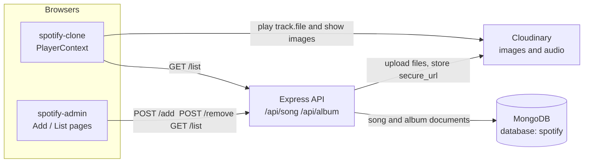
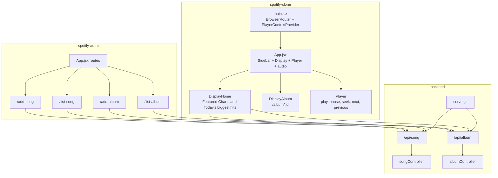
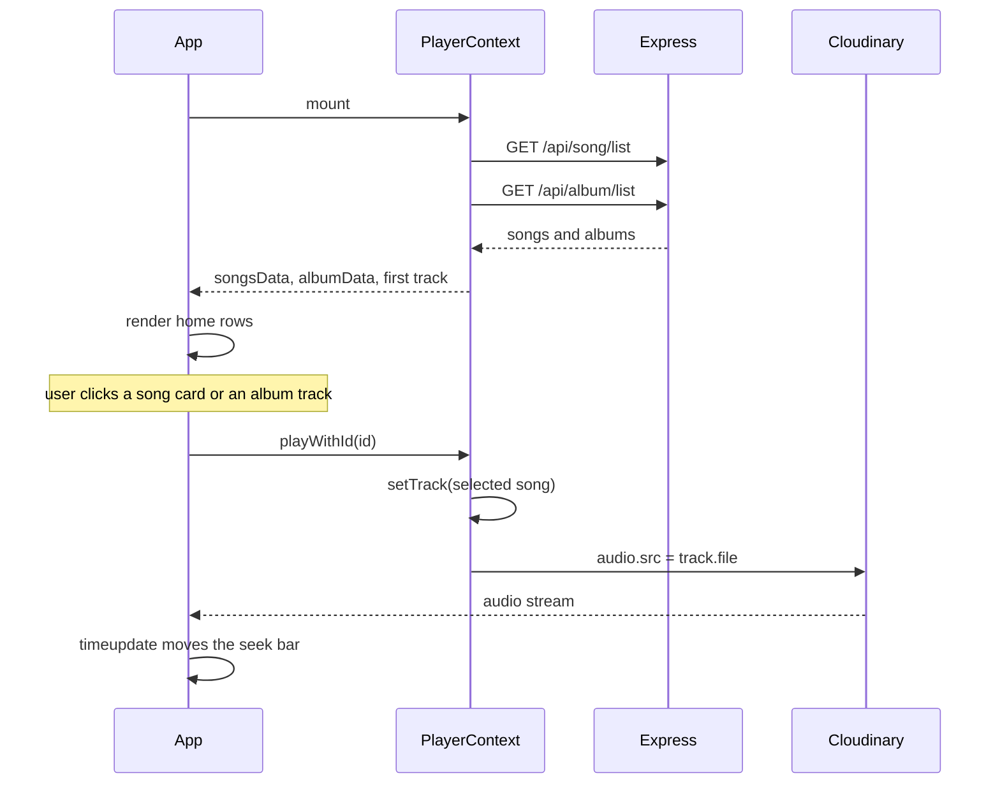
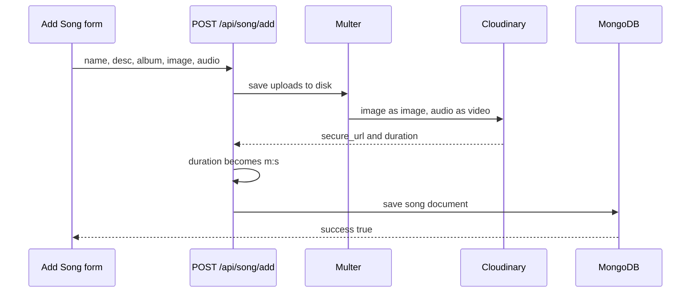

# Spotify Clone

A three-part music app. An admin panel uploads albums and songs, an Express API stores the metadata in MongoDB and the files in Cloudinary, and a listener UI plays that catalog.

Both front ends currently call the hosted API at `https://spotify-clone-backend-rctz.onrender.com`.

Architecture diagrams and data flow live in [ARCHITECTURE.md](ARCHITECTURE.md). The plan for growing this into a million-user system is in [SCALING-PLAN.md](SCALING-PLAN.md).

## Repository layout

```text
Spotify-clone/
├── spotify-clone/     Listener UI (React + Vite). Home, album pages, player.
├── spotify-admin/     Admin UI (React + Vite). Add and remove albums and songs.
└── backend/           Express API. MongoDB models, Cloudinary uploads.
```

| App | Stack | Default command | Role |
| --- | --- | --- | --- |
| `spotify-clone` | React 18, React Router 6, Axios, Tailwind | `npm run dev` (port 5173) | Browse and play |
| `spotify-admin` | React 18, React Router 6, Axios, MUI, Toastify, Tailwind | `npm run dev` (port 5173) | Manage the catalog |
| `backend` | Express 4, Mongoose, Multer, Cloudinary | `npm start` (port 4000) | Persist metadata and files |

Run the admin app on another port so it does not collide with the listener: `npm run dev -- --port 5174`.

## System architecture



A song is linked to an album by **name**, not by MongoDB id. `song.album` is the album’s `name` string. The album page keeps songs where `item.album === album.name`.



## How the listener works

`PlayerContext` is the single source of playback state. On mount it loads the catalog, then the rest of the UI reads that context.



1. `main.jsx` wraps the app in `BrowserRouter` and `PlayerContextProvider`.
2. The provider calls `GET /api/song/list` and `GET /api/album/list`, stores both arrays, and selects the first song as `track`.
3. `App` stays on a loading message until `songsData` has items. It then renders the sidebar, the main display (95% height), and the bottom player. A hidden `<audio>` element holds `track.file`.
4. **Home (`/`)** shows albums under “Featured Charts” and songs under “Today's biggest hits”.
5. Clicking an album navigates to `/album/:id`. `Display` paints a gradient from that album’s `bgColor` into `#121212`. The page lists songs whose `album` field matches the album name. Clicking a row calls `playWithId`.
6. Changing `track` sets `audio.src` and calls `play()`. Play and pause toggle the element. Next and previous walk `songsData` by index. Clicking the seek bar sets `currentTime` from the click position. A `timeupdate` listener writes elapsed time and the green progress width.

The sidebar Home control returns to `/`. Search, library, playlist, and podcast blocks are layout only. Shuffle, loop, and the volume icons in the player are layout only.

## How the admin works

The admin shell is a sidebar plus four routes. Every write sends `multipart/form-data`. Toasts report success and failure.



| Route | Page | What it does |
| --- | --- | --- |
| `/add-album` | `AddAlbum` | Name, description, background color, cover image. `POST /api/album/add`. |
| `/list-album` | `ListAlbum` | Table of albums. Delete calls `POST /api/album/remove` with `{ id }`. |
| `/add-song` | `AddSong` | Name, description, album name (loaded from `/api/album/list`), cover, audio file. `POST /api/song/add`. |
| `/list-song` | `ListSong` | Table of songs. Delete calls `POST /api/song/remove` with `{ id }`. |

Album color is a hex value. The listener uses it only as the album-page gradient.

## How the API works

`backend/server.js` connects to MongoDB and Cloudinary, enables JSON, URL-encoded bodies, and CORS, then mounts the routers.

| Method | Path | Body | Result |
| --- | --- | --- | --- |
| `GET` | `/` | — | Plain text `Api working` |
| `POST` | `/api/song/add` | Fields `name`, `desc`, `album`. Files `image`, `audio`. | Uploads both files. Saves `{ name, desc, album, image, file, duration }`. |
| `GET` | `/api/song/list` | — | `{ success: true, songs: [...] }` |
| `POST` | `/api/song/remove` | `{ id }` | Deletes the song document. |
| `POST` | `/api/album/add` | Fields `name`, `desc`, `bgColor`. File `image`. | Uploads the cover. Saves the album. |
| `GET` | `/api/album/list` | — | `{ success: "true", album: [...] }` |
| `POST` | `/api/album/remove` | `{ id }` | Deletes the album document. |

Audio is uploaded to Cloudinary with `resource_type: "video"` so Cloudinary returns a duration. The controller stores that duration as `minutes:seconds`. Image and audio URLs saved on the document are Cloudinary `secure_url` values. Removing a song or album deletes the MongoDB document; it does not delete the Cloudinary asset.

Song responses use a boolean `success`. Album responses use the strings `"true"` and `"false"`.

### Documents

**Song** (`song` collection): `name`, `desc`, `album`, `image`, `file`, `duration`. All required.

**Album** (`album` collection): `name`, `desc`, `bgColor`, `image`. All required.

MongoDB is `${MONGODB_URI}/spotify`.

## Backend folders

```text
backend/
├── server.js
└── src/
    ├── config/        mongodb.js, cloudinary.js
    ├── middleware/    multer.js          disk storage, original filename
    ├── models/        songModel.js, albumModel.js
    ├── controllers/   songController.js, albumController.js
    └── routes/        songRoute.js, albumRoute.js
```

## Run it locally

Use three terminals.

```bash
# API
cd backend
npm install
# create backend/.env — see variables below
npm start

# Listener — http://localhost:5173
cd spotify-clone
npm install
npm run dev

# Admin — http://localhost:5174
cd spotify-admin
npm install
npm run dev -- --port 5174
```

To talk to a local API, point both clients at it:

- `spotify-clone/src/context/PlayerContext.jsx` — `url`
- `spotify-admin/src/App.jsx` — exported `url`

Set that value to `http://localhost:4000`.

### `backend/.env`

```text
PORT=4000
MONGODB_URI=mongodb+srv://<user>:<password>@<cluster>
CLOUDINARY_NAME=
CLOUDINARY_API_KEY=
CLOUDINARY_SECRET_KEY=
```

`PORT` is optional. The server falls back to `4000`.
