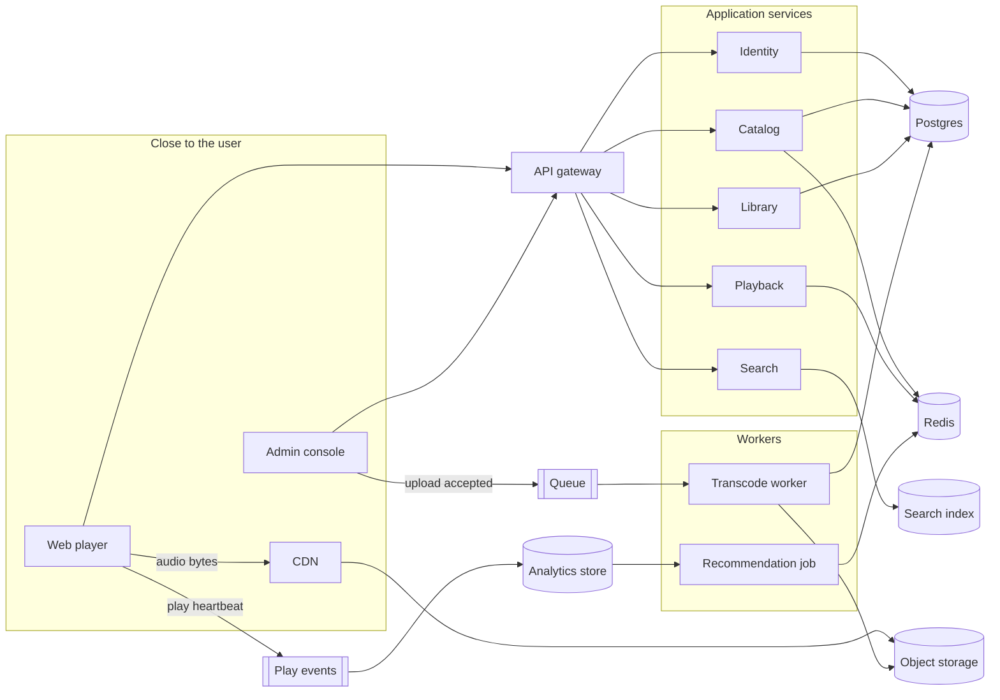
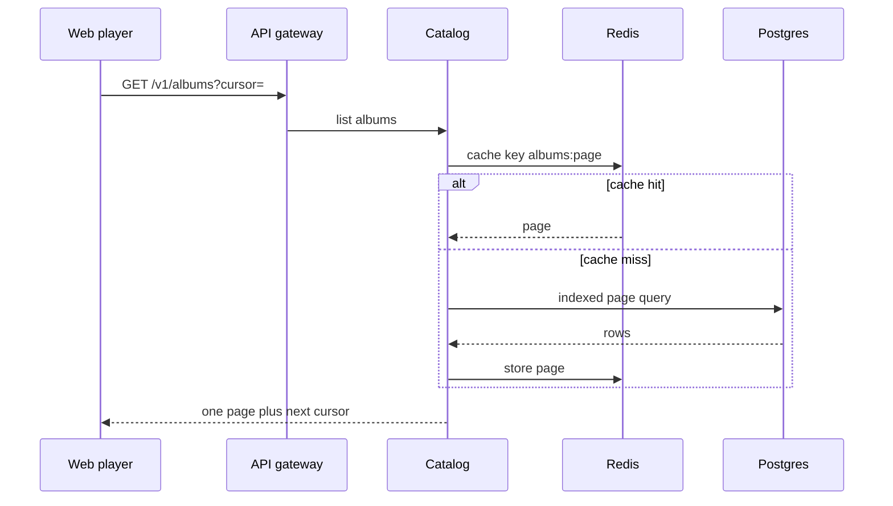
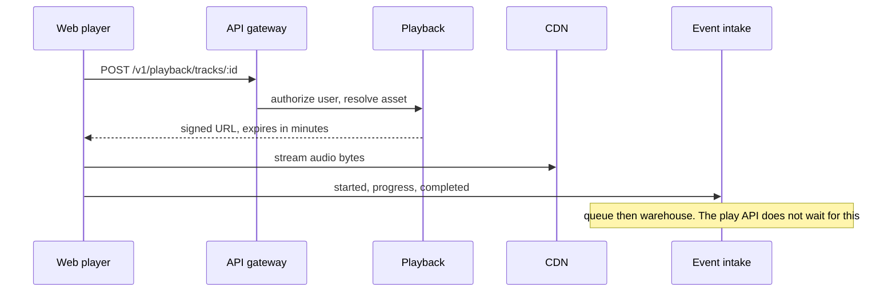
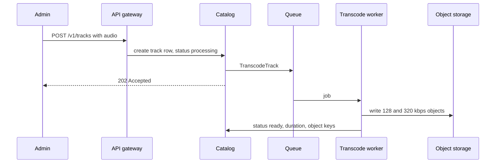

# Scaling plan

This is a learning plan for taking the current Spotify clone from one small API toward an architecture that can serve about **1 million registered users**. The target is the shape used by large music products such as Spotify: the app that lists songs is separate from the network that delivers audio, and play history is collected as events for search and recommendations.

Build it in phases. A million-user design is a set of boundaries and numbers. It is a bad first step to split this repo into dozens of services.

The current system is documented in [ARCHITECTURE.md](ARCHITECTURE.md).

## What one million users means

“One million users” is a registration count. The servers feel three smaller numbers.

| Figure | Planning value | Why it matters |
| --- | --- | --- |
| Registered users | 1,000,000 | Size of the user and library tables |
| Daily active users | 100,000 (about 10%) | How many people open the app on a busy day |
| Concurrent listeners | 10,000 | How much audio bandwidth is in flight at once |
| Catalog size to design for | 1 million tracks, 100,000 albums | Browse, search, and album pages must be paged |

Audio dominates cost. At 128 kbps, one listener is about 16 KB/s. Ten thousand listeners at once are about **1.3 Gbps**. That stream has to come from a CDN. The Express process that today saves a song must never be the process that sends those bytes.

Design targets for the finished system:

| Path | Target |
| --- | --- |
| Home and album metadata | p95 under 200 ms |
| “Start this track” API | p95 under 150 ms, returns a short-lived stream URL |
| Audio bytes | Served by the CDN, close to the listener |
| Upload | HTTP request only accepts the file and returns; transcoding happens on a worker |
| Play events | Acknowledged quickly, processed from a queue |

## Why the current app stays small

These are the limits in this repository, in the order they start to hurt.

| Today | File | What breaks as traffic grows |
| --- | --- | --- |
| One Express process does uploads, lists, and deletes | `backend/server.js` | A slow Cloudinary upload occupies the same process that should answer “list songs” |
| The browser downloads every song and every album on load | `PlayerContext.jsx` | Payload grows with the whole catalog. A million tracks cannot be one JSON array |
| Songs point at albums by name | `songModel.js`, `DisplayAlbum.jsx` | Rename, duplicate names, and “songs in this album” all become wrong. Joins need an id |
| Audio URL is a permanent public Cloudinary link | `songController.js` | No per-user permission, no expiry, no bitrate choice |
| No user accounts | both front ends | Library, playlists, and “recently played” have nowhere to live |
| Delete removes only the MongoDB document | `songController.js`, `albumController.js` | Storage fills with orphaned files |
| API host is hardcoded | `PlayerContext.jsx`, `spotify-admin/src/App.jsx` | Local, staging, and production cannot be configured apart |
| CORS is open to every origin | `server.js` | Any website can call the API |

Cloudinary already hints at the right split: files live outside MongoDB, and the player loads the URL itself. The scaled design keeps that split and makes it explicit.

## Five separations

Large streaming systems keep these jobs apart. Each one fails and scales differently.

1. **Identity.** Who is calling, and are they a listener or an admin.
2. **Catalog.** Artists, albums, tracks, artwork URLs. Read-heavy, cacheable.
3. **Media.** The audio bytes, transcoded into a few bitrates, stored as objects, delivered by a CDN.
4. **Library.** This user’s playlists, likes, and follows. Tied to a user id.
5. **Activity.** Play, pause, skip, and “listened 30 seconds.” Write-heavy events. Recommendations read them later, off the play button’s path.



Through phase 2 these boxes are **modules inside one backend**, not separate deployables. Extract a module into its own service only when its traffic, its failure mode, or its team boundary is actually different. Media transcoding and play-event intake are the first two worth extracting.

## Target request paths

### Browse



The home screen asks for a page of albums and a page of tracks. It does not ask for the catalog.

### Play



The play API returns a URL. The CDN returns music. A third call records what happened.

### Upload



The admin request ends when the job is queued. Listeners see the track after its status is `ready`.

## Data model

Replace the name link with foreign keys. Duration becomes a number of seconds. The public player never stores a permanent audio URL; it receives a signed one.

```text
users
  id, email, password_hash, role (listener | admin), created_at

artists
  id, name, image_key

albums
  id, artist_id, name, description, bg_color, image_key, released_on

tracks
  id, album_id, artist_id, name, description,
  duration_seconds, status (processing | ready | failed),
  image_key, created_at

audio_assets
  id, track_id, bitrate_kbps, object_key, bytes

playlists
  id, owner_id, name, description

playlist_tracks
  playlist_id, track_id, position

likes
  user_id, track_id, created_at

play_events          -- analytics store, not the catalog database
  event_id, user_id, track_id, ms_played, at
```

`image_key` and `object_key` are paths in object storage. The catalog database stores keys. The CDN URL is built when a response is sent.

Indexes to add with the tables: `tracks(album_id)`, `tracks(artist_id)`, `playlist_tracks(playlist_id, position)`, `likes(user_id, track_id)`, and a unique `(email)` on users.

## How the current code maps forward

| Current | Becomes |
| --- | --- |
| `songModel` + `albumModel` | `tracks`, `albums`, `artists`, `audio_assets` |
| `album` string on a song | `tracks.album_id` |
| `multer` then Cloudinary inside `addSong` | Accept the file, enqueue `TranscodeTrack`, worker writes objects |
| `PlayerContext` loading `/api/song/list` | Paged `GET /v1/tracks` and `GET /v1/albums` |
| `<audio src={track.file}>` | `<audio src={signedUrl}>` from `POST /v1/playback/tracks/:id` |
| Admin list/delete pages | Same screens, calling `/v1`, with track `status` |
| Sidebar search box | `GET /v1/search?q=` once the index exists |
| “Create playlist” button | Real `playlists` rows after identity exists |

Suggested module layout inside `backend/` once phase 1 starts. One process, one database, clear folders:

```text
backend/src/
├── modules/
│   ├── identity/
│   ├── catalog/
│   ├── media/
│   ├── library/
│   ├── playback/
│   └── activity/
├── shared/          db, cache, queue, object storage, logger
└── app.js           mounts module routers behind /v1
```

Each module owns its routes, its queries, and its tables. Other modules call a function in that module, or publish an event. They do not import another module’s tables.

## Phases

Each phase is shippable. Leave the next phase’s technology out until the checklist for this one passes.

### Phase 0 — Make the small app honest

Learning goal: configuration, identity basics, and a data model you can join.

- Move the API base URL to `VITE_API_URL` in both front ends.
- Add `GET /health` that checks the database.
- Add users with hashed passwords and two roles: listener and admin. Admin routes require the admin role.
- Add `album_id` on songs and stop matching albums by name. Keep accepting the old name only long enough to backfill ids.
- Store duration as integer seconds. Format `m:ss` in the UI.
- Page every list: `?limit=20&cursor=`.
- Restrict CORS to the listener origin and the admin origin.
- Write request logs with a request id.

Done when: a new album name no longer hides its songs, home loads one page, and an anonymous caller cannot add a track.

### Phase 1 — Modular monolith

Learning goal: boundaries without a distributed system.

- Restructure `backend/src` into the modules above. Still one Node process and one datastore.
- Introduce Postgres for users, artists, albums, tracks, playlists, and likes. MongoDB can stay only until the data is copied.
- Put Redis in front of album and track pages. Invalidate a key when that album or track changes.
- Add playlists and likes for the signed-in user. Wire the buttons that are currently layout-only.
- Add OpenAPI for `/v1` so the listener and the admin share one contract.

Done when: you can draw each feature to one module, and a catalog page is served from Redis on the second request.

### Phase 2 — Get audio off the API

Learning goal: object storage, CDNs, queues, and slow work moved off the request.

- Store images and audio in object storage (S3, Cloudflare R2, or GCS).
- On upload, save the object, insert the track as `processing`, and enqueue a job.
- A worker writes at least two bitrates and marks the track `ready`.
- `POST /v1/playback/tracks/:id` checks the user and returns a URL that expires in a few minutes.
- The player sets `audio.src` to that URL. The browser talks to the CDN.
- Deleting a track deletes the database row and enqueues deletion of its objects.
- Add a rate limit on upload and on login, stored in Redis.

Done when: starting a song does not send audio bytes through Express, and uploading a large file returns before transcoding finishes.

This is the phase that makes 10,000 concurrent listeners possible. Phases 3 and 4 make the product larger. They do not replace the CDN.

### Phase 3 — Search, library, and events

Learning goal: read models and asynchronous facts.

- Index artists, albums, and ready tracks in OpenSearch (or Elasticsearch). `GET /v1/search` queries the index, then loads the current rows from Postgres by id.
- On publish, the catalog module emits `TrackReady`. A small consumer updates the index. Use an outbox table in Postgres so the event and the track insert commit together.
- The player sends `playback.started`, `playback.progress`, and `playback.completed` to `POST /v1/activity`. That handler only validates and enqueues.
- A consumer appends those events to an analytics table or a warehouse. It also updates “recently played” for that user.
- Home can show “Made for you” as the user’s recent tracks plus a simple “popular this week” count. A full recommender waits for phase 4.

Done when: search works without scanning Postgres, and a play still starts if the analytics consumer is stopped.

### Phase 4 — Several services, one region first

Learning goal: network failures, independent deploys, and backpressure.

Extract only these three from the monolith:

| Service | Why it leaves the monolith | Scales on |
| --- | --- | --- |
| Media worker | CPU-heavy, slow, retryable | Queue depth |
| Activity intake | Huge write rate, must not slow playback | Events per second |
| Search | Its own index and memory profile | Query rate |

Catalog, identity, library, and playback stay in the modular monolith until a measurement says one of them needs its own deploy. Put an API gateway in front (a managed gateway, or a thin Node/Nginx edge) for TLS, auth checks, and rate limits.

Run at least two instances of the monolith behind a load balancer. Use a Postgres primary plus one read replica for catalog list queries. Keep writes on the primary.

Add tracing (OpenTelemetry) across gateway, monolith, and workers. Alert on: API error rate, p95 latency, queue age, CDN 5xx, and database connections in use.

Done when: you can stop the activity consumer or the search indexer and the player still browses and plays. You can add a second API instance without sticky sessions.

### Phase 5 — A second region, only after phase 4 is boring

Learning goal: latency to users who are far from the database.

- CDN already covers global audio. Metadata for a second region is the new problem.
- Put the read replica, Redis, and gateway in the second region. Writes stay in the home region.
- Cache album and track pages aggressively. A minute of staleness on a chart is acceptable.
- Do not start here. Multi-region data is a separate course after one region is observable.

## Technology choices for this repo

Pick boring tools so the lesson is the boundary, not the product.

| Concern | Use | Leave for later |
| --- | --- | --- |
| Catalog and users | PostgreSQL | A different database per service |
| Cache, rate limit, queue | Redis and BullMQ | Kafka, until play events are the bottleneck you are studying |
| Audio and images | S3-compatible bucket + CDN | Serving files from the API disk |
| Search | OpenSearch | `LIKE` queries once you have passed a few thousand tracks |
| Auth | Short-lived access token, rotating refresh token, `argon2` passwords | Building an identity provider |
| API style | JSON `/v1` over HTTPS | gRPC on the public web API. gRPC fits service-to-service later |
| Run | One container for the API, one for the worker, managed Postgres and Redis | Kubernetes, until you have the three extracted services |
| Front end | Keep the two Vite apps. Add login, paging, and signed playback | A rewrite in another framework |

Spotify’s own estate is hundreds of services on Google Cloud, with client telemetry as a major pipeline and audio delivered from a media edge rather than from the metadata API. Copy those **separations**. Copying their service count would hide the lessons inside operational work.

## Capacity sketch for phase 2

Use this to decide instance size. Revisit it with real metrics after launch.

| Workload | Rough load | Where it lands |
| --- | --- | --- |
| 10,000 streams at 128 kbps | ~1.3 Gbps | CDN and object storage |
| 100,000 DAU, ~20 catalog requests each | ~2 million catalog reads/day, bursts of tens of QPS | Redis, then Postgres |
| Uploads | Admin-scale, bursty, each file large | Queue and worker, not the request thread pool |
| Play events, 10,000 listeners heartbeating every 30 s | ~300 events/s | Activity queue. The play API stays out of this path |

Tens of catalog requests per second is comfortable for Postgres plus Redis. The design limit is the audio path and unbounded list responses, which phases 0 and 2 remove.

## Build order for a student

Work in this order so each week has a running app.

1. Environment-based API URL, health check, and paged lists.
2. `album_id` migration and album page filter by id.
3. Users, login, and admin-only uploads.
4. Module folders, still one server.
5. Postgres and a one-time copy from MongoDB.
6. Redis cache on album and track pages.
7. Object storage, signed playback URL, worker for duration and bitrate.
8. Playlists and likes.
9. Search index and `TrackReady` outbox.
10. Play-event endpoint that only enqueues.
11. Second API instance and a load balancer.
12. Extract the worker, then activity intake, then search.

After step 7 you can explain, with a diagram, how the app would carry 10,000 concurrent listeners. After step 11 you can explain how a metadata deploy stays separate from audio delivery.

## Checks before calling a phase done

- Lists return a cursor, and the client requests the next page on scroll.
- A track with `status != ready` cannot be played.
- The signed audio URL fails after it expires.
- Stopping Redis makes catalog slower and still correct.
- Stopping the worker leaves new tracks in `processing` and leaves old tracks playable.
- Two API instances serve the same user without pinning that user to one machine.
- Logs for one song upload share one request id from the admin click to the worker.

## What this plan leaves out on purpose

Licensing, DRM, offline downloads, social graph, lyrics, podcasts, and a trained recommendation model are real parts of Spotify and poor next steps here. Add them after playback, identity, and events are in place. A first recommender can be “tracks this user finished” plus “tracks often played by people who played this one,” computed nightly from `play_events` into Redis. That is enough to learn the pipeline.
