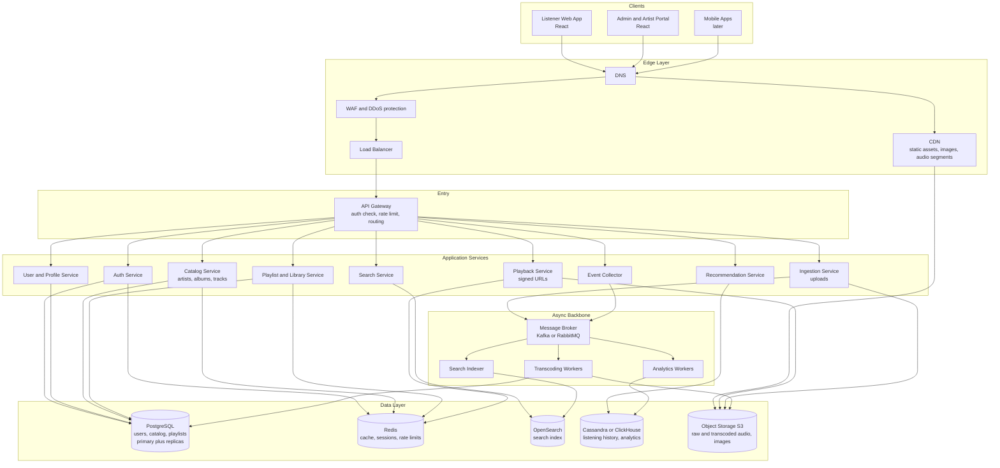
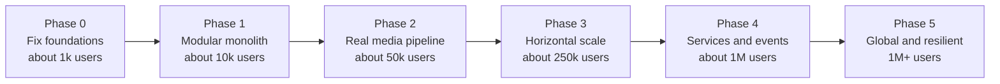
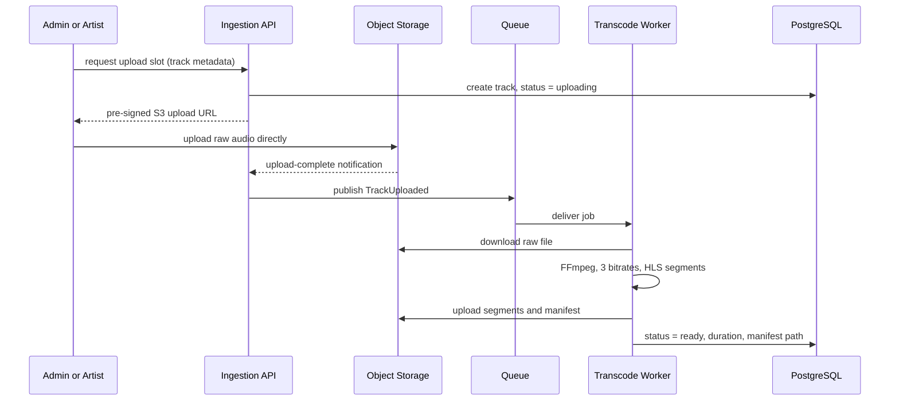
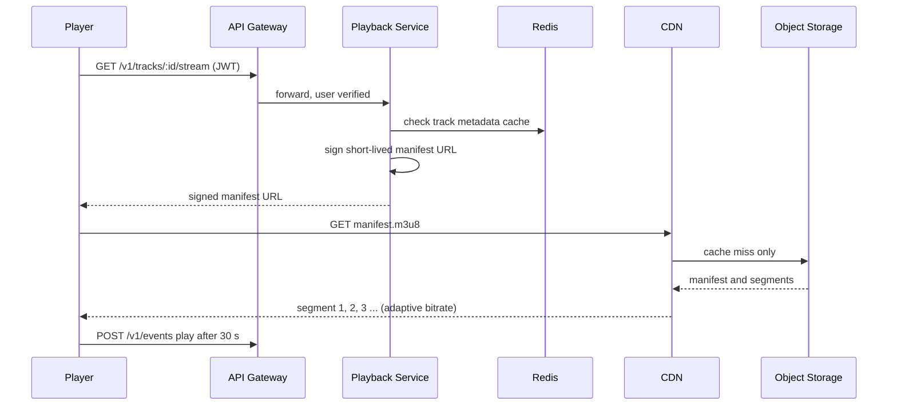
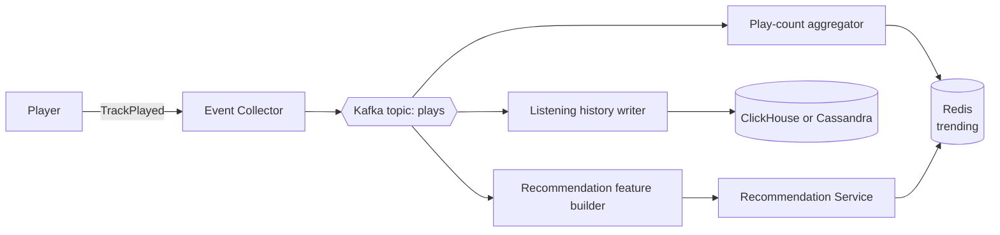

# Scaling Plan: Spotify Clone to 1 Million Users

A learning-focused roadmap for taking the current three-app project (React listener, React admin, single Express API) to an architecture modelled on how large music-streaming platforms work.

> **Honest advice first:** real companies do not jump from a simple app to hundreds of microservices. They scale in *phases*, and each phase is driven by a measured bottleneck. This plan follows that path so you learn *why* every piece exists, not just what it is.

---

## 1. Goals and numbers

### 1.1 Target

| Metric | Target |
| --- | --- |
| Registered users | 1,000,000 |
| Daily active users (DAU) | ~200,000 (20%) |
| Peak concurrent listeners | ~50,000 |
| Plays per DAU per day | ~30 |
| Catalog size | 1,000,000 tracks |
| Availability | 99.9% (about 8.7 hours downtime per year) |
| API latency (p95) | < 200 ms |
| Playback start time | < 1 second |

### 1.2 Back-of-envelope capacity

These estimates tell you *what must be built* before you build it.

| Question | Calculation | Result |
| --- | --- | --- |
| Plays per day | 200,000 x 30 | 6 million |
| Average plays per second | 6,000,000 / 86,400 | about 70 /s |
| Peak plays per second (x5) | 70 x 5 | about 350 /s |
| Audio bandwidth for 50k listeners | 50,000 x 128 kbps (16 KB/s) | about 6.4 Gbps |
| Storage for 1M tracks | 1M x ~4 MB x 3 quality levels | about 12 TB |
| Listening-history events | 6M plays x ~3 events each | about 18M events per day |
| Metadata API read:write ratio | browsing vs. admin edits | roughly 1000:1 |

**What the numbers teach you:**

1. **Audio bandwidth is the real monster (6.4 Gbps).** Your API servers must never carry audio bytes. A CDN has to.
2. **Metadata traffic is read-heavy (1000:1).** Aggressive caching and read replicas solve most of it.
3. **18M events per day is write-heavy.** It cannot go through your main database. It needs a queue and an analytics store.
4. **350 plays per second is small.** One well-tuned service handles it. The difficulty is bandwidth, data volume, and reliability, not request rate.

---

## 2. Where the current app breaks

Your current design is a good prototype. Here is what fails at scale, and which phase fixes it.

| # | Current behaviour | Why it breaks | Fixed in |
| --- | --- | --- | --- |
| 1 | `GET /api/song/list` returns **every** song | 1M songs = hundreds of MB per request | Phase 0 |
| 2 | Song links to album by **name string** | Renaming or duplicate names corrupts data; no joins | Phase 0/1 |
| 3 | No authentication, admin routes are open | Anyone can delete the catalog | Phase 0/1 |
| 4 | No users, playlists, likes, history | Not a real product yet | Phase 1 |
| 5 | Multer saves files to local disk | Lost on redeploy, breaks with more than one server | Phase 2 |
| 6 | Audio served as one file from Cloudinary | Cost explodes; no adaptive bitrate; no seek-friendly chunks | Phase 2 |
| 7 | One Express process on a free host | Single point of failure; cold starts | Phase 3 |
| 8 | No caching | Every page view hits MongoDB | Phase 1/3 |
| 9 | No search | Cannot find 1M tracks by scrolling | Phase 3 |
| 10 | Deleting leaves Cloudinary files orphaned | Storage leak | Phase 2 |
| 11 | Mixed `success` types (boolean and string) | Fragile clients | Phase 0 |
| 12 | No logs, metrics, tracing | You cannot fix what you cannot see | Phase 3/5 |

---

## 3. Target architecture (end state)



### Core design principles (copied from real streaming platforms)

| Principle | What it means here |
| --- | --- |
| **Separate the control plane from the data plane** | APIs decide *who may play what*. The CDN moves the actual audio bytes. |
| **Cache everything that is read often** | Browser, CDN, Redis, then database. |
| **Use async for anything not needed in the response** | Transcoding, indexing, analytics go through a queue. |
| **Stateless services** | Any instance can serve any request, so you scale by adding instances. |
| **Right database for each job** | Relational for core data, search engine for search, wide-column or columnar for event firehose. |
| **Design for failure** | Retries, timeouts, circuit breakers, graceful degradation. |

---

## 4. The scaling roadmap



> **Rule:** do not start a phase until you can *prove* the previous one with a load test or a measured exit criterion.

---

### Phase 0: Fix the foundations

**Goal:** make the current app correct, safe, and reproducible.

**Tasks**

- [ ] Add **pagination** to every list endpoint (`?limit=20&cursor=...`).
- [ ] Replace `song.album = "name"` with `song.albumId = <id>` (a real reference).
- [ ] Add **input validation** (Zod or Joi) and one **consistent response shape**:
  ```json
  { "success": true, "data": { }, "error": null }
  ```
- [ ] Add **JWT authentication** and a `role` field (`user`, `admin`). Protect all admin routes.
- [ ] Add `helmet`, restricted **CORS**, and request **rate limiting**.
- [ ] Add a central **error handler** and structured logging (`pino`).
- [ ] Put config in `.env` with a validated schema; never commit secrets.
- [ ] Write a `Dockerfile` for the backend and a `docker-compose.yml` for local dev.
- [ ] Add **tests** (Jest + Supertest) and a **GitHub Actions** pipeline (lint, test, build).
- [ ] Add a `/health` endpoint.

**Exit criteria:** `docker compose up` runs everything; tests pass in CI; no unauthenticated write endpoint exists.

**You will learn:** REST design, authentication, validation, Docker, CI.

---

### Phase 1: Modular monolith with proper data model

**Goal:** a real product (users, playlists, likes) on a clean, well-separated codebase. Still **one deployable app**.

**Tasks**

- [ ] Restructure the backend into **modules** with strict boundaries (see section 8).
- [ ] Move core data to **PostgreSQL** (relational integrity, joins, transactions). See schema in section 6.
- [ ] Add modules: `auth`, `users`, `catalog`, `playlists`, `library` (likes/follows), `playback`.
- [ ] Add **Redis** for caching catalog reads and storing refresh tokens.
- [ ] Add **database indexes** and check them with `EXPLAIN ANALYZE`.
- [ ] Add **refresh-token rotation** and password hashing with `argon2` or `bcrypt`.
- [ ] Add an **OpenAPI** spec (Swagger) so the API is documented.
- [ ] Frontend: use **React Query** (server-state cache), **infinite scroll**, and route-level code splitting.

**Exit criteria:** p95 under 200 ms at 500 requests per second (k6 test) on a single small instance.

**You will learn:** relational modelling, indexing, caching, modular design.

> **Why a modular monolith before microservices?** Microservices add network failures, distributed transactions, and deployment complexity. You should split only when a module needs independent scaling or a separate team. A well-modularised monolith lets you split later with little rewriting.

---

### Phase 2: A real media pipeline (the Spotify core)

**Goal:** stream audio the way streaming platforms do: adaptive, chunked, CDN-delivered.

**Tasks**

- [ ] Move file storage from local disk/Cloudinary to **S3-compatible object storage** (AWS S3, Cloudflare R2, or MinIO locally).
- [ ] Upload with **pre-signed URLs**: the browser uploads directly to S3 and the API never touches the bytes.
- [ ] Add a **message queue** (RabbitMQ or Redis-based BullMQ to start).
- [ ] Build a **transcoding worker** using FFmpeg: raw upload becomes 3 qualities (for example 96, 160, 320 kbps) split into short **HLS segments** (about 10 s each) plus a manifest (`.m3u8`).
- [ ] Put a **CDN** (CloudFront, Cloudflare) in front of the storage bucket.
- [ ] Playback service returns a **short-lived signed URL** to the manifest after checking auth.
- [ ] Frontend player: use **hls.js**, prefetch the next track, and add volume, shuffle, repeat (currently layout only).
- [ ] Add **cleanup**: deleting a track removes the files from storage via a background job.

**Exit criteria:** audio starts in under 1 s on a throttled connection; changing network quality switches bitrate; API servers show near-zero audio bandwidth.





**You will learn:** object storage, signed URLs, CDNs, FFmpeg, HLS, queues and workers.

---

### Phase 3: Horizontal scaling and search

**Goal:** remove every single point of failure; handle 250k users.

**Tasks**

- [ ] Deploy as **containers** (AWS ECS/Fargate, Google Cloud Run, or Kubernetes with k3s/minikube for learning).
- [ ] Run **at least 2-3 stateless API instances** behind a **load balancer** with health checks.
- [ ] Configure **autoscaling** on CPU and request count.
- [ ] Postgres: add **read replicas**; send reads to replicas, writes to the primary. Add **PgBouncer** connection pooling.
- [ ] Redis: move to a managed instance with replication.
- [ ] Add **OpenSearch/Elasticsearch** for search: full-text, fuzzy matching, autocomplete across tracks, artists, albums. Keep it in sync with a queue-fed **indexer**.
- [ ] Add **rate limiting** per user and per IP using Redis (token bucket).
- [ ] Add **observability**: structured logs, Prometheus metrics, Grafana dashboards, OpenTelemetry tracing.
- [ ] Add **blue/green or rolling deployments** so releases cause no downtime.
- [ ] Run **load tests** with k6 and record results.

**Exit criteria:** kill one API instance during a load test and users notice nothing; search returns in under 100 ms.

**You will learn:** load balancing, replication, connection pooling, search engines, observability.

---

### Phase 4: Extract services and add an event backbone

**Goal:** scale teams and workloads independently; add analytics and recommendations.

**Tasks**

- [ ] Introduce **Kafka** (or Redpanda, which is Kafka-compatible and lighter for learning).
- [ ] Define events: `TrackPlayed`, `TrackLiked`, `PlaylistUpdated`, `TrackUploaded`, `TrackReady`.
- [ ] Add an **API Gateway** (Kong, NGINX, or AWS API Gateway) for routing, auth verification, and rate limits.
- [ ] Extract services **one at a time**, in this order (highest scaling pressure first):
  1. **Playback and Event Collector** (highest traffic)
  2. **Search** (separate scaling profile)
  3. **Ingestion and Transcoding** (CPU heavy)
  4. **Recommendation** (batch/ML)
  5. Keep Catalog, Users, Playlists together until there is a clear reason to split.
- [ ] Store listening history in **Cassandra** or **ClickHouse** (write-optimised, time-series friendly).
- [ ] Build simple recommendations:
  - "Recently played" and "Top tracks" (counts from events)
  - "Because you listened to X" (item-to-item co-occurrence)
  - "Daily Mix" (batch job, results cached in Redis)
- [ ] Use the **Outbox pattern** so a database write and an event publish never get out of sync.
- [ ] Make consumers **idempotent** (processing the same event twice is harmless).
- [ ] Add **circuit breakers and retries with backoff** between services.

**Exit criteria:** you can deploy the Search service without redeploying anything else; replaying events rebuilds the analytics store.



**You will learn:** event-driven design, Kafka, eventual consistency, idempotency, outbox pattern.

---

### Phase 5: Global, resilient, and cost-aware

**Goal:** survive regional failures and serve users worldwide cheaply.

**Tasks**

- [ ] **Multi-AZ** deployment first, then optionally **multi-region** (active-passive for the database, active-active for stateless services and CDN).
- [ ] **Backups** and tested **restore drills**; define RPO and RTO.
- [ ] **Chaos testing**: randomly stop instances and dependencies.
- [ ] Add **feature flags** and **canary releases**.
- [ ] **Infrastructure as Code** (Terraform) for everything.
- [ ] Add **security hardening**: secrets manager, least-privilege IAM, dependency scanning, audit logs.
- [ ] **Cost review**: CDN cache hit ratio (target above 95%), storage tiering for old data, right-sizing instances.
- [ ] Define **SLOs** (for example, 99.9% of playback starts under 1 s) and alert on error budgets.

**You will learn:** reliability engineering, disaster recovery, IaC, FinOps.

---

## 5. Technology choices

Choose the "Learning-friendly" column if you want free tiers and easy local setup. The "Production" column is what companies commonly use.

| Concern | Learning-friendly (free/local) | Production-scale |
| --- | --- | --- |
| Backend | Node.js + Express or NestJS | Node/NestJS, Go, or Java for hot paths |
| Core database | PostgreSQL (Docker, Neon, Supabase) | Managed PostgreSQL/Aurora with replicas |
| Cache | Redis (Docker) | Managed Redis cluster |
| Object storage | MinIO (local), Cloudflare R2 free tier | AWS S3 |
| CDN | Cloudflare free tier | CloudFront / Cloudflare / Akamai |
| Queue | BullMQ or RabbitMQ | Kafka |
| Search | Meilisearch or Typesense (easy) | OpenSearch / Elasticsearch |
| Event store / analytics | PostgreSQL table or ClickHouse (Docker) | Cassandra, ClickHouse, BigQuery |
| Transcoding | FFmpeg in a Node worker | AWS MediaConvert or autoscaled FFmpeg workers |
| Streaming format | HLS with hls.js | HLS / DASH with DRM where required |
| Gateway | NGINX | Kong, Envoy, AWS API Gateway |
| Containers | Docker Compose, then k3s | Kubernetes (EKS/GKE) |
| IaC | Docker Compose | Terraform |
| CI/CD | GitHub Actions | GitHub Actions + Argo CD |
| Monitoring | Prometheus + Grafana (Docker) | Grafana stack / Datadog |
| Load testing | k6 | k6 / Gatling in CI |

**Why PostgreSQL instead of MongoDB for the core?** Your data is highly relational (users, playlists, tracks, albums, artists). Joins, foreign keys, and transactions matter here. MongoDB is fine, but a relational database is the safer and more commonly expected choice for this domain. Using the right tool per job is the lesson.

---

## 6. Data design

### 6.1 Relational schema (PostgreSQL)

```sql
CREATE TABLE users (
  id            UUID PRIMARY KEY DEFAULT gen_random_uuid(),
  email         TEXT UNIQUE NOT NULL,
  password_hash TEXT NOT NULL,
  display_name  TEXT NOT NULL,
  role          TEXT NOT NULL DEFAULT 'user',      -- user | artist | admin
  created_at    TIMESTAMPTZ NOT NULL DEFAULT now()
);

CREATE TABLE artists (
  id         UUID PRIMARY KEY DEFAULT gen_random_uuid(),
  name       TEXT NOT NULL,
  image_url  TEXT,
  user_id    UUID REFERENCES users(id)             -- optional owner account
);

CREATE TABLE albums (
  id         UUID PRIMARY KEY DEFAULT gen_random_uuid(),
  artist_id  UUID NOT NULL REFERENCES artists(id),
  title      TEXT NOT NULL,
  description TEXT,
  bg_color   TEXT,
  cover_url  TEXT,
  released_at DATE
);

CREATE TABLE tracks (
  id            UUID PRIMARY KEY DEFAULT gen_random_uuid(),
  album_id      UUID NOT NULL REFERENCES albums(id),
  artist_id     UUID NOT NULL REFERENCES artists(id),
  title         TEXT NOT NULL,
  duration_ms   INT,
  track_number  INT,
  status        TEXT NOT NULL DEFAULT 'uploading', -- uploading | processing | ready | failed
  manifest_path TEXT,                              -- HLS manifest in object storage
  play_count    BIGINT NOT NULL DEFAULT 0,         -- denormalised, updated in batches
  created_at    TIMESTAMPTZ NOT NULL DEFAULT now()
);

CREATE TABLE playlists (
  id         UUID PRIMARY KEY DEFAULT gen_random_uuid(),
  owner_id   UUID NOT NULL REFERENCES users(id),
  name       TEXT NOT NULL,
  is_public  BOOLEAN NOT NULL DEFAULT false,
  created_at TIMESTAMPTZ NOT NULL DEFAULT now()
);

CREATE TABLE playlist_tracks (
  playlist_id UUID REFERENCES playlists(id) ON DELETE CASCADE,
  track_id    UUID REFERENCES tracks(id)   ON DELETE CASCADE,
  position    INT  NOT NULL,
  added_at    TIMESTAMPTZ NOT NULL DEFAULT now(),
  PRIMARY KEY (playlist_id, track_id)
);

CREATE TABLE liked_tracks (
  user_id  UUID REFERENCES users(id) ON DELETE CASCADE,
  track_id UUID REFERENCES tracks(id) ON DELETE CASCADE,
  liked_at TIMESTAMPTZ NOT NULL DEFAULT now(),
  PRIMARY KEY (user_id, track_id)
);

-- Indexes driven by real queries
CREATE INDEX idx_tracks_album       ON tracks (album_id, track_number);
CREATE INDEX idx_albums_artist      ON albums (artist_id);
CREATE INDEX idx_playlists_owner    ON playlists (owner_id);
CREATE INDEX idx_liked_user_time    ON liked_tracks (user_id, liked_at DESC);
```

### 6.2 Listening history (write-heavy, query by user and time)

Cassandra-style model (partition by user, cluster by time descending):

```text
listening_history
  partition key : user_id
  clustering key: played_at DESC
  columns       : track_id, album_id, artist_id, ms_played, device, source
```

This answers "what did this user play recently?" with a single partition read, and it handles millions of writes per day because writes are append-only.

### 6.3 Which store owns which data

| Data | Store | Reason |
| --- | --- | --- |
| Users, catalog, playlists, likes | PostgreSQL | Relational, transactional |
| Hot catalog reads, sessions, rate limits, trending | Redis | In-memory speed |
| Searchable text | OpenSearch | Full-text and fuzzy search |
| Listening history, analytics | Cassandra / ClickHouse | Append-heavy firehose |
| Audio, images | Object storage + CDN | Cheap, durable, cacheable |

### 6.4 Caching strategy

| Layer | What | TTL (example) |
| --- | --- | --- |
| Browser | Static JS/CSS (hashed filenames) | 1 year |
| CDN | Images, audio segments | 30 days |
| CDN | Public catalog API responses | 30-60 s |
| Redis | Album, track, artist objects (cache-aside) | 5-10 min |
| Redis | Trending and home-page rows | 1-5 min |
| Redis | User's liked-track ID set | until changed |

**Cache-aside pattern:** read Redis; on miss read Postgres, then write to Redis. On update, delete the cache key. Protect against **cache stampede** with request coalescing or a short lock.

---

## 7. API design (v1)

Versioned, resource-oriented, cursor-paginated.

| Method | Path | Notes |
| --- | --- | --- |
| `POST` | `/v1/auth/register` | Create account |
| `POST` | `/v1/auth/login` | Returns access + refresh tokens |
| `POST` | `/v1/auth/refresh` | Rotates refresh token |
| `GET` | `/v1/me` | Current user |
| `GET` | `/v1/albums?limit=20&cursor=...` | Paginated |
| `GET` | `/v1/albums/:id` | Album plus first page of tracks |
| `GET` | `/v1/albums/:id/tracks` | Paginated tracks |
| `GET` | `/v1/tracks/:id` | Track metadata |
| `GET` | `/v1/tracks/:id/stream` | Signed manifest URL (auth required) |
| `GET` | `/v1/search?q=...&type=track,album,artist` | Served by search index |
| `GET` | `/v1/me/playlists` | User playlists |
| `POST` | `/v1/playlists` | Create playlist |
| `POST` | `/v1/playlists/:id/tracks` | Add track |
| `PUT` | `/v1/me/likes/:trackId` | Like (idempotent) |
| `DELETE` | `/v1/me/likes/:trackId` | Unlike (idempotent) |
| `GET` | `/v1/me/history` | Recently played |
| `POST` | `/v1/events` | Batched play events from client |
| `POST` | `/v1/admin/tracks` | Create track + get upload URL (admin/artist) |

**Cursor pagination example**

```json
{
  "success": true,
  "data": [ { "id": "...", "title": "..." } ],
  "page": { "nextCursor": "eyJpZCI6Ii4uLiJ9", "limit": 20 }
}
```

Cursor pagination (keyset) stays fast on deep pages. `OFFSET 900000` does not.

---

## 8. Target code structure

Start with this as a modular monolith in Phase 1. Each folder under `modules/` can later become its own service.

```text
spotify-platform/
├── apps/
│   ├── web/                    listener UI (React)
│   ├── admin/                  admin and artist portal (React)
│   └── api/                    modular monolith, later split
│       └── src/
│           ├── modules/
│           │   ├── auth/       routes, controller, service, repo, schema
│           │   ├── users/
│           │   ├── catalog/    artists, albums, tracks
│           │   ├── playlists/
│           │   ├── library/    likes, follows
│           │   ├── playback/   signed URLs
│           │   ├── search/
│           │   └── events/
│           ├── shared/         logger, errors, config, db, cache, queue
│           └── server.ts
├── workers/
│   ├── transcoder/             FFmpeg HLS jobs
│   ├── indexer/                keeps search in sync
│   └── analytics/              aggregates play events
├── packages/
│   ├── types/                  shared TypeScript types and API contracts
│   └── eslint-config/
├── infra/
│   ├── docker-compose.yml
│   ├── k8s/                    manifests
│   └── terraform/
├── tests/
│   ├── load/                   k6 scripts
│   └── e2e/
├── docs/
│   ├── adr/                    architecture decision records
│   └── runbooks/
└── .github/workflows/
```

**Layering rule inside every module:** `route -> controller -> service -> repository`. Controllers never talk to the database. Modules talk to each other only through exported service interfaces, never by reaching into another module's tables.

**Write ADRs:** for each big decision (for example "Why Postgres over Mongo"), write a half-page record: context, options, decision, consequences. This is a habit that makes a strong portfolio.

---

## 9. Reliability and security checklist

**Reliability**

- [ ] Timeouts on every outbound call
- [ ] Retries with exponential backoff and jitter (only for idempotent calls)
- [ ] Circuit breakers between services
- [ ] Graceful shutdown (finish in-flight requests on SIGTERM)
- [ ] Dead-letter queues for failed jobs
- [ ] Health checks: liveness and readiness
- [ ] Database migrations versioned (Prisma Migrate, Knex, or Flyway)
- [ ] Daily backups and one tested restore

**Security**

- [ ] Passwords hashed with argon2/bcrypt, never logged
- [ ] Short-lived access tokens (about 15 min), rotating refresh tokens
- [ ] Role-based access control on every admin route
- [ ] Signed, expiring URLs for audio; private bucket
- [ ] Validate file type and size on upload; scan if possible
- [ ] Rate limits on login and search endpoints
- [ ] HTTPS only, secure headers (`helmet`), strict CORS
- [ ] Secrets in a secrets manager, not in the repo
- [ ] Dependency scanning (`npm audit`, Dependabot)

---

## 10. Observability

| Pillar | Tooling | Examples |
| --- | --- | --- |
| Logs | pino to Loki / ELK | Request id, user id, error stack |
| Metrics | Prometheus + Grafana | Request rate, error rate, p95 latency, cache hit ratio, queue depth |
| Traces | OpenTelemetry + Jaeger | One request across gateway, service, DB |
| Alerts | Alertmanager | Error rate above 2%, p95 above 500 ms, queue backlog growing |

**The four golden signals** to dashboard for every service: *latency, traffic, errors, saturation*.

**Sample SLOs**

| SLO | Target |
| --- | --- |
| API availability | 99.9% |
| Playback start under 1 s | 99% of plays |
| Search p95 | under 150 ms |
| Upload to "ready" | under 5 minutes |

---

## 11. Load testing example (k6)

```javascript
import http from 'k6/http';
import { check, sleep } from 'k6';

export const options = {
  stages: [
    { duration: '2m', target: 200 },    // ramp up
    { duration: '5m', target: 1000 },   // sustained load
    { duration: '2m', target: 0 },      // ramp down
  ],
  thresholds: {
    http_req_failed:   ['rate<0.01'],
    http_req_duration: ['p(95)<200'],
  },
};

export default function () {
  const res = http.get(`${__ENV.BASE_URL}/v1/albums?limit=20`);
  check(res, { 'status is 200': (r) => r.status === 200 });
  sleep(1);
}
```

Run a test at the end of every phase and save the results in `docs/benchmarks/`. A before-and-after table is the best proof of your learning.

---

## 12. Suggested learning schedule

| Weeks | Phase | Main deliverable |
| --- | --- | --- |
| 1-2 | Phase 0 | Auth, pagination, Docker, CI |
| 3-5 | Phase 1 | Postgres schema, modules, Redis cache, playlists and likes |
| 6-8 | Phase 2 | S3/MinIO uploads, FFmpeg + HLS worker, CDN, hls.js player |
| 9-10 | Phase 3 | Multi-instance deploy, load balancer, search, dashboards |
| 11-13 | Phase 4 | Kafka events, extracted playback/search services, recommendations |
| 14+ | Phase 5 | Terraform, chaos tests, multi-AZ, SLOs |

**Do not skip the measuring.** At the end of each phase, run k6 and write down what the bottleneck is. That is the real skill.

---

## 13. Trade-offs to understand and be able to explain

| Topic | Question to answer in an interview |
| --- | --- |
| Monolith vs microservices | Why did you wait until Phase 4 to split? |
| SQL vs NoSQL | Why Postgres for catalog but Cassandra for history? |
| Consistency | Where is eventual consistency acceptable (play counts) and where not (payments, ownership)? |
| Caching | How do you invalidate? What happens in a cache stampede? |
| Queues | What if a job runs twice? What if it never runs? |
| CDN | How do you keep audio private yet cacheable? (signed URLs, cookies) |
| Scaling | Vertical vs horizontal; what makes a service stateless? |
| CAP theorem | What does each of your stores choose during a network partition? |

---

## 14. Quick start: your first 7 days

1. Create a new repo structure (section 8) and a `docker-compose.yml` with Postgres, Redis, and MinIO.
2. Port `songs` and `albums` to the Postgres schema; use `album_id` foreign keys.
3. Add register/login with JWT and protect admin routes.
4. Add cursor pagination to album and track listing.
5. Add Redis cache-aside for `GET /v1/albums/:id`.
6. Add a GitHub Actions workflow that runs lint and tests.
7. Run your first k6 test and record the baseline numbers.

After that, continue with Phase 2. Every later step builds on measurements from this baseline.

---

## 15. Glossary

| Term | Meaning |
| --- | --- |
| **CDN** | Network of edge servers that cache content near users |
| **HLS** | HTTP Live Streaming: audio/video split into small segments with a manifest |
| **Adaptive bitrate** | Player switches quality based on current bandwidth |
| **Pre-signed URL** | Temporary URL granting limited access to a private object |
| **Cache-aside** | App checks cache first, loads from DB on miss, then fills cache |
| **Read replica** | Read-only copy of a database used to spread read load |
| **Idempotent** | Doing it twice has the same effect as doing it once |
| **Outbox pattern** | Save the event in the same DB transaction as the data, then publish it reliably |
| **SLO** | Service Level Objective: the reliability target you promise |
| **Sharding** | Splitting data across multiple databases by key |
| **Backpressure** | Slowing producers when consumers cannot keep up |
